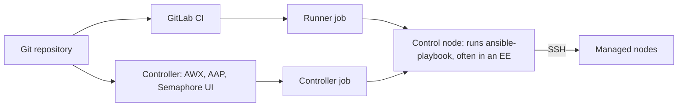

# Control node, runner, controller: who runs your Ansible, and how Tower became AWX and AAP

First entry in the Running IaC and CaC from a controller series. *Infrastructure as code* (IaC) means describing servers, networks and their configuration in files kept in Git, and letting a tool apply them: Ansible for configuration, [Terraform/OpenTofu](../terraform/what-is-terraform-opentofu-and-how-it-works.md) for provisioning, [Packer](../packer/what-is-packer-and-how-it-works.md) for machine images. *Configuration as code* (CaC) is the configuration part of it, applied to two kinds of systems in this series: the servers, configured by Ansible, and the tools themselves, starting with GitLab, whose projects, variables and runners can be managed by OpenTofu instead of by clicking. This series is about running those tools from a central place, triggered by changes in Git, instead of from someone's laptop.

Three words come up as soon as Ansible leaves the laptop: *control node*, *runner* and *controller*. They overlap, vendors reuse them with other meanings, and one product has had three names. This entry sorts them out before the next ones use them.

## Three roles

**Control node.** Ansible's own documentation defines it as *"the machine from which you run the Ansible CLI tools (`ansible-playbook`, `ansible`, `ansible-vault` and others)"* ([Ansible concepts](https://github.com/ansible/ansible-documentation/blob/devel/docs/docsite/rst/shared_snippets/basic_concepts.txt)). The machines it configures are the *managed nodes*, listed in the [inventory](inventory-hosts-groups-all-ungrouped.md). Ansible is agentless: nothing of Ansible runs on a managed node, the control node connects to it, usually over SSH. The control node can be a container: an *execution environment* (EE) is a container image holding ansible-core, collections and their dependencies, built as in [the Ansible development environment series](execution-environment-from-a-locked-requirements-file.md). The same docs add that *"multiple control nodes are possible, but Ansible itself does not coordinate across them"*. Coordination is what the two other roles add.

**Runner.** A CI/CD system splits work into *pipelines* made of *jobs*; a *runner* is the agent that picks up a job and runs it ([the GitLab CI entry](../gitlab-ci/ansible-lint-custom-python-image.md) defines these terms). GitLab's documentation: *"GitLab Runner connects to your GitLab instance and waits for CI/CD jobs. When a pipeline runs, GitLab sends jobs to available runners. The runner executes the job and reports the results back to GitLab"* ([GitLab Runner](https://docs.gitlab.com/runner/)). The runner's *executor* decides where the job's commands run: in a shell on the runner's machine, in a Docker container, in a Kubernetes pod and so on. A runner knows nothing about Ansible; a job that calls `ansible-playbook` makes the machine or container it runs in the control node for that run.

**Controller.** A service dedicated to running automation: it stores *projects* (a Git repository with playbooks), inventories, credentials and *templates* (a playbook with its inventory and credentials), launches runs on demand or on a schedule, keeps the history of every run and decides who may launch what. AWX, Red Hat's *automation controller* and Semaphore UI are controllers. A controller's run also ends with `ansible-playbook` running somewhere, and that somewhere is the control node.

So the question "where does Ansible run?" has two layers: what decides to run it (a person, a CI pipeline, a controller), and which machine or container is the control node when it does.

## The same words, other meanings in AAP

*Red Hat Ansible Automation Platform* (AAP) is Red Hat's subscription product built around the automation controller. Its *automation mesh* documentation uses node names of its own ([AAP 2.6, planning for automation mesh](https://docs.redhat.com/en/documentation/red_hat_ansible_automation_platform/2.6/administer-assembly_planning_mesh)):

| AAP node type | What it does | In Ansible's own terms |
|---|---|---|
| Control node | *"Control nodes run project and inventory updates and system jobs, but not regular jobs. Execution capabilities are disabled on these nodes."* | not a control node: it runs no playbook |
| Hybrid node | the default for the control plane; runs controller services and also jobs | a control node when it runs a job |
| Execution node | *"Execution nodes run jobs under ansible-runner with podman isolation"*; no control functions | the control node of the jobs it runs |
| Hop node | routes traffic to execution nodes, like a jump host; runs no automation | not a control node |

The control plane is the set of services that store and schedule (web server, task dispatcher); the execution plane is where jobs run. *ansible-runner* is the Python library and command that controllers use to start `ansible-playbook` and collect its events. In AAP's vocabulary, then, an Ansible control node is an *execution* node, and an AAP *control* node never runs a playbook. When a page says "control node", check whose vocabulary it uses.

## How Tower became AWX and AAP

| When | What happened | Source |
|---|---|---|
| until 2014 | AnsibleWorks, the company behind Ansible, sold a web interface called AWX; it was renamed Ansible Tower with version 1.4 | [eWeek, 2017](https://www.eweek.com/de/enterprise-apps/red-hat-launches-open-source-ansible-tower-awx-automation-project/) |
| October 2015 | Red Hat acquired Ansible; Tower stayed proprietary | same |
| 7 September 2017 | Red Hat published Tower's code as the open-source AWX project, under the Apache 2.0 licence; Tower 3.2 was the first release built from it | same, and [SiliconANGLE](https://siliconangle.com/blog/2017/09/07/red-hat-expands-ansibles-enterprise-automation-portfolio-new-releases/) |
| 2021 | AAP 2.0: Tower was renamed *automation controller* (version 4.0), and execution environments replaced the separate Ansible Engine runtime | [Red Hat blog](https://www.redhat.com/en/blog/whats-new-in-ansible-automation-platform-2-automation-controller) |
| 2 July 2024 | AWX 24.6.1, the last AWX release so far; *"Releases of this project are now paused during a large scale refactoring"* | [AWX README](https://github.com/ansible/awx) |
| 1 October 2024 | AAP 2.5: a *platform gateway* puts controller, automation hub and Event-Driven Ansible behind one interface and one login; a containerized installer joins the RPM installer (now deprecated) and the Kubernetes operator | [AAP 2.5 release notes](https://docs.redhat.com/en/documentation/red_hat_ansible_automation_platform/2.5/html-single/release_notes/index), [Red Hat Developer](https://developers.redhat.com/blog/2024/10/01/whats-new-red-hat-ansible-automation-platform-25) |

AWX stands to AAP's controller as Fedora to Red Hat Enterprise Linux, in the words Red Hat used in 2017: the upstream project that the product is built from. AWX is still *"one of the upstream projects for Red Hat Ansible Automation Platform"* (its README), and its code still changes on the `devel` branch, but nothing has been released from it since July 2024. The name "AWX" therefore means two different things depending on the date: the commercial product before 2014, or the open-source upstream since 2017.

When reading an article or a forum answer, the name dates it:

- **"Tower"**: written before AAP 2.0 (2021); the concepts mostly hold, the installation steps and the Ansible Engine runtime don't.
- **"automation controller"**: AAP 2.x.
- **"platform gateway"**, a single login for all of AAP: AAP 2.5 or later.
- **"AWX"**: the open-source upstream, with its last release in July 2024, or, before 2014, the product that became Tower.

## Where the series goes next

The next entry compares the controllers that are realistic in 2026: AWX with its releases paused, AAP, Semaphore UI, and no controller at all, a GitLab pipeline whose runner job is the control node. The third looks at what GitOps means for tools such as Ansible and OpenTofu, which act only when something runs them. The examples run against a lab of GitLab CE, GitLab Runner and Semaphore UI in Docker, in the companion repository [abdelhousni/iac-controller-series](https://github.com/abdelhousni/iac-controller-series); AAP is described from Red Hat's documentation, not run.
