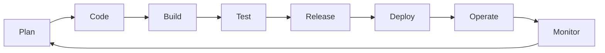
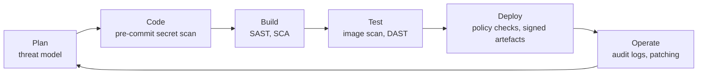
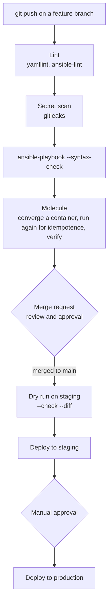
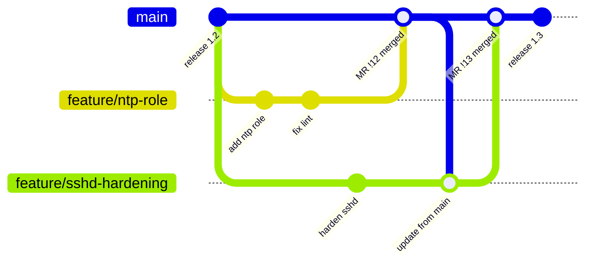
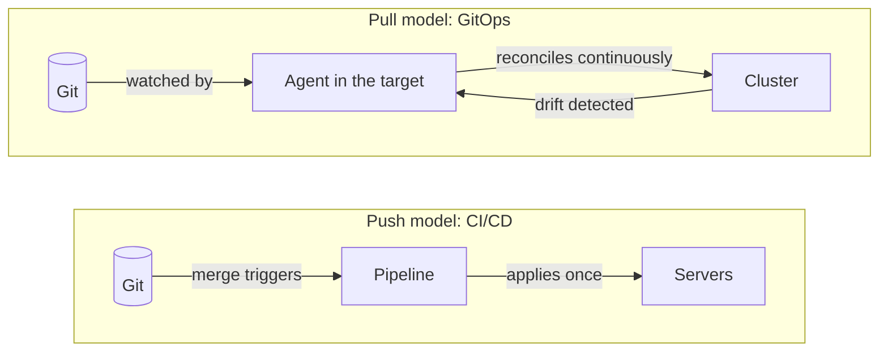

# DevOps and DevSecOps terminology: DORA metrics, CI/CD for Ansible, feature branches and GitOps

A glossary-style entry for the words that come up as soon as infrastructure code goes through a pipeline: what DevOps and DevSecOps mean and how they differ, how the DORA metrics measure delivery, what CI/CD looks like when the code is an Ansible playbook, how a feature-branch workflow keeps `main` deployable, and where GitOps fits.

## DevOps

*DevOps* is a way of organising software delivery in which the people who write a change (development) and the people who run it in production (operations) share one goal and one workflow, instead of handing work over a wall. It is a set of practices and a culture, not a tool or a job title. The practices most often named are:

- **Automation** of building, testing and deploying, so a change goes to production the same way every time.
- **Small, frequent changes**, which are easier to review and to roll back than large releases.
- **Infrastructure as Code (IaC)**: servers, networks and configuration described in files kept in version control, then applied by a tool such as [OpenTofu](../terraform/what-is-terraform-opentofu-and-how-it-works.md) or Ansible. *Configuration as Code (CaC)* is the same idea for what runs on the servers.
- **Feedback**: monitoring, logs and measurements, so the team sees the effect of a change quickly.

The loop is usually drawn as an infinity sign; as a cycle:



## DevSecOps

*DevSecOps* adds security to the same loop. In a classic process, security reviews a finished release just before it ships, when a finding is expensive to fix. DevSecOps moves the checks earlier ("shift left") and automates them, so they run on every change like the tests do. Security becomes a shared responsibility rather than a final gate owned by another team.

Typical automated checks, and where they run:

| Check | What it looks for | Example for IaC |
|---|---|---|
| Secret scanning | passwords, tokens or keys committed to Git | `gitleaks`, GitHub secret scanning |
| SAST (static application security testing) | dangerous patterns in source code, without running it | `KICS` or `checkov` on playbooks and Terraform |
| SCA (software composition analysis) | dependencies with known vulnerabilities | collections and Python packages in an execution environment |
| Image scanning | vulnerable packages in a container image | `trivy` on the image a job runs in |
| DAST (dynamic application security testing) | weaknesses in the running application | tests against a staging deployment |
| Policy as code | rules a change must respect, written as code | Open Policy Agent, `ansible-lint` profiles |



### DevOps and DevSecOps compared

| | DevOps | DevSecOps |
|---|---|---|
| Goal | deliver changes fast and reliably | the same, with security built in |
| Who owns security | often a separate team at the end | everyone, from the first commit |
| When security is checked | before release, manually | on every change, automatically |
| Pipeline | build, test, deploy | build, test, **scan**, deploy |
| Typical failure it prevents | a broken deployment | a broken deployment, a leaked secret, a vulnerable dependency |

DevSecOps is not a separate method: it is DevOps in which security checks are part of "done".

## DORA metrics

DORA (DevOps Research and Assessment) is a research programme run by Google Cloud that surveys thousands of teams every year for its *Accelerate State of DevOps* report. It found that a few measurements predict how well a team delivers software. It started with four, the "four keys", and since the 2024 report it uses five, in two groups ([DORA's software delivery performance metrics](https://dora.dev/guides/dora-metrics/)):

| Group | Metric | DORA's definition |
|---|---|---|
| Throughput | Change lead time | *"The amount of time it takes for a change to go from committed to version control to deployed in production."* |
| Throughput | Deployment frequency | *"The number of deployments over a given period or the time between deployments."* |
| Throughput | Failed deployment recovery time | *"The time it takes to recover from a deployment that fails and requires immediate intervention."* |
| Instability | Change fail rate | *"The ratio of deployments that require immediate intervention following a deployment."* |
| Instability | Deployment rework rate | *"The ratio of deployments that are unplanned but happen as a result of an incident in production."* |

The metrics changed over time ([history of DORA's metrics](https://dora.dev/insights/dora-metrics-history/)): failed deployment recovery time replaced *mean time to restore* (MTTR) in the 2023 report, which narrowed it to failures caused by a change to production, and rework rate was added as the fifth metric in 2024, when recovery time also moved from the stability group to throughput.

Speed and the failure metrics are measured together, so that deploying more often only counts as progress if failures don't rise. DORA reports that they are not a trade-off: *"speed and stability are not tradeoffs. In fact, we see that the metrics are correlated for most teams. Top performers do well across all five metrics, and low performers do poorly."*

For an Ansible repository, the metrics map to things a pipeline already records: merges to `main` that ran the deploy job (frequency), the time between the first commit of a merge request and its deploy job (lead time), deploy jobs followed by a revert or a fix (change fail rate), unplanned deploys made to fix an incident (rework rate), and the time until the next successful deploy (recovery).

## CI/CD applied to IaC: Ansible as an example

- **Continuous integration (CI)**: every change is merged into the shared branch often, and each push runs automated checks, so problems show up while the change is small.
- **Continuous delivery (CD)**: every change that passes CI is ready to deploy, and deploying is one button, often behind a manual approval.
- **Continuous deployment**: the same, without the button: every change that passes goes to production automatically.

With application code, CI builds and tests a binary. With Ansible, there is nothing to compile, so CI checks the playbooks and tests them against throwaway hosts:



What each step brings:

- **Lint**: `ansible-lint` flags deprecated modules, missing names and risky patterns such as `shell` where a module exists ([how to run it in the editor and in CI](../ansible/ansible-lint-fix-in-the-editor-and-in-ci.md)).
- **Molecule** is the Ansible tool that creates a test instance (often a container), runs the role against it, runs it a second time to check that nothing changes (*idempotence*: the same result however many times it runs), and runs verification tests. `molecule test` runs that whole sequence, then destroys the instance; the steps are listed in the scenario's `test_sequence`.
- **`--check --diff`** runs the playbook in dry-run mode and shows the changes it would make, the Ansible equivalent of `tofu plan`.
- **The same execution environment everywhere**: running every job in one pinned container image keeps the Ansible version and collections identical between CI, staging and production ([building one from a locked requirements file](../ansible/execution-environment-from-a-locked-requirements-file.md)).
- **Secrets** come from the CI platform's protected variables or a vault at run time, never from the repository.

A minimal GitLab CI file with those stages:

```yaml
stages: [lint, test, deploy]

default:
  image: registry.example.com/ansible-ee:1.4.0

lint:
  stage: lint
  script:
    - yamllint .
    - ansible-lint

molecule:
  stage: test
  script:
    - molecule test

deploy_staging:
  stage: deploy
  script:
    - ansible-playbook -i inventories/staging site.yml
  rules:
    - if: $CI_COMMIT_BRANCH == $CI_DEFAULT_BRANCH

deploy_production:
  stage: deploy
  script:
    - ansible-playbook -i inventories/production site.yml
  rules:
    - if: $CI_COMMIT_BRANCH == $CI_DEFAULT_BRANCH
      when: manual
```

## The feature-branch workflow

In a *feature-branch* workflow, `main` always holds code that can be deployed, and nobody commits to it directly. Each change is made on its own short-lived branch, checked by CI, reviewed in a merge request (a pull request on GitHub), and merged only when both pass.



The workflow is sometimes sold under names such as a "no-rework architecture"; that isn't a standard term, but it describes the aim: catch a problem on the branch, before the merge, so that nothing has to be redone on `main`. What makes that work:

- **Branch protection**: `main` refuses direct pushes and requires a passing pipeline and an approval before a merge.
- **The same checks on the branch as on `main`**: lint, secret scan and Molecule run on every push, so the merge request shows the result before anyone reviews it.
- **Short-lived branches**: a branch that lives for days drifts away from `main` and ends in a large merge conflict, which is rework of its own. Merging `main` into the branch, or merging the branch often, keeps the difference small.
- **One change per branch**: a small merge request is reviewed faster and reverted more easily.

It connects back to DORA: changes that are caught on the branch never count as failed deployments (change fail rate, rework rate), and small branches reach production sooner (lead time).

*Trunk-based development* takes the same idea further: branches last hours rather than days, and unfinished work is hidden behind feature flags instead of kept on a branch. *Git flow* goes the other way, with long-lived `develop` and `release` branches; it suits software shipped in versions more than infrastructure deployed continuously.

## GitOps

*GitOps* uses a Git repository as the single source of truth for the desired state of a system, and lets software agents apply it. The [OpenGitOps](https://opengitops.dev/) project defines four principles: the desired state is declarative, versioned and immutable, pulled automatically by an agent, and continuously reconciled with the actual state.

The difference with a CI/CD pipeline is the direction and the timing:



- In the **push** model, a pipeline applies the change when something is merged; between two runs nothing checks that the servers still match Git.
- In the **pull** model, an agent such as Argo CD or Flux runs next to the system, watches the repository, and corrects *drift* (the actual state moving away from the desired state), including drift caused by a manual change outside Git.

Ansible and OpenTofu are push tools, so a pipeline that runs them meets only some of the principles. The [GitOps with push tools entry](../gitops/gitops-with-push-tools-ansible-opentofu.md) compares them principle by principle.

## Other terms that come with these

- **Shift left**: moving a check earlier in the cycle, where a problem is cheaper to fix.
- **Pipeline as code**: the CI/CD pipeline itself is a file in the repository (`.gitlab-ci.yml`, `.github/workflows/*.yml`), reviewed like any other change.
- **Immutable infrastructure**: servers are replaced by new ones built from an image rather than modified in place.
- **Drift**: the difference between what the code describes and what is actually running.
- **SBOM (software bill of materials)**: a list of every component and version inside an artefact, used to find what a new vulnerability affects.
- **Supply chain security**: making sure that what is deployed is what was built from reviewed code, for example by signing artefacts (Sigstore) and recording how they were built (SLSA).
- **Blue-green and canary deployments**: releasing to a second environment or to a small share of servers first, so a failure affects few users and is quick to undo.
