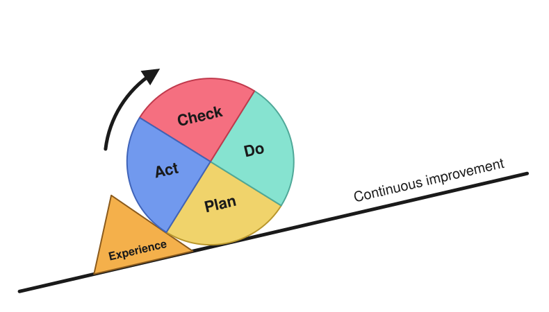

# PDCA, the Deming cycle, as a DevSecOps service design process

Second entry in the DevSecOps for Linux, applied series. The [first entry](devops-devsecops-dora-cicd-gitops-terminology.md) defines DevOps, DevSecOps, the DORA metrics and the feature-branch workflow. This one covers the loop that decides what to build and whether it worked: *PDCA* (Plan, Do, Check, Act), also drawn as the *Deming wheel*. Chapter 2 of Marco Antonio Carcano's *[DevSecOps and DevOps for Linux: The Foundations](https://link.springer.com/book/9798868820762)*, "Solution Lifecycle", calls it "one of the most used solution design frameworks" and builds its service design process on it. [Rémi Poillot's French introduction](https://remi-poillot.fr/la-methode-pdca-roue-de-deming/) adds the picture of the wheel held by a wedge. This entry puts the two together and applies them to a sysadmin's work: a security check rolled out to a team's repositories, and a VM provisioning chain made faster.

## Where it comes from

Walter Shewhart, a statistician at Bell Laboratories, described a cycle for quality control. W. Edwards Deming, who learned it from him, taught it to Japanese industry in the 1950s, and it spread from there as PDCA. Deming later preferred *PDSA*, with **Study** in place of **Check**. In [The Deming Institute's words](https://deming.org/explore/pdsa/), Check looks at "the success or failure of a Plan", while Study compares the actual results with the results predicted at the start, in order to revise the theory behind the plan. That is why the examples below write down a prediction in Plan: it makes Check more than "did it work?".

## The four steps

The book and the article describe the same four steps. The book's version is aimed at a technical service, and it adds two details that matter in practice: Do is done **on a small scale**, and a successful Act **standardises** the change and rolls it out more widely.

1. **Plan**: identify the problem or the opportunity, set the objectives, work out the resources needed (people, equipment, information) and the steps to reach the result, with deadlines. The article recommends a *SMART* objective: Specific, Measurable, Achievable, Realistic and Time-bound, so that Check has a number and a date to compare against.
2. **Do**: carry out the plan on a small scale, collect data on the outcome and document what was done.
3. **Check**: analyse that data. Were the objectives met, and where do the actual results differ from the expected ones (in quantity, quality, cost or time)?
4. **Act**: act on what Check found. If the plan worked, standardise it and apply it on a larger scale. If it didn't, revise the plan and go round again. Either way, keep what worked as well as fixing what didn't.

The article draws the wheel rolling up a slope with a **wedge** behind it: the experience gained in a cycle is what stops the wheel from rolling back down. It also insists on learning from successes as well as failures, because a success nobody analyses isn't repeated on purpose.

<figure>

<figcaption>The wheel climbs the slope one cycle at a time, and the wedge of experience stops it from rolling back. Drawn for this site after <a href="https://remi-poillot.fr/la-methode-pdca-roue-de-deming/">Rémi Poillot's picture</a>.</figcaption>
</figure>

## The book's service design steps

The book turns the cycle into concrete steps for designing a service (its Table 2-2). The book doesn't sort the steps into the four phases; the Phase column below is this entry's reading. The last column is how each step looks with the tools this series uses.

| Step | What the book asks for | Phase | In our work |
|---|---|---|---|
| Gathering requirements | Work with the *product owner* (the person on the business side who owns the request) to turn business requirements into technical ones, and fix the scope early | Plan | An issue that states the need, the scope and what is out of it |
| Challenging the requirements | A request can hide a misconception; refine it to avoid building what isn't needed | Plan | Asking what the requested VM, port or access is for, before granting it |
| Find the right products | Unless asked to build a product, look for existing ones that fit, and combine them if needed | Plan | Stock tools first: GitLab CE, Artifactory, upstream Ansible roles and collections |
| Initial design | A first design from the products' documentation, without trusting it blindly; plan for maintainability and security from the start | Plan | An ADR (architecture decision record) for each choice, a threat model, naming conventions |
| Set up a lab environment | Disposable instances for research and destructive tests, such as a risky upgrade; kept for the whole life of the service | Do | The Proxmox and RKE2 lab, containers, where roles, playbooks and Helm charts run first |
| Live demo | Show the stakeholders a working subset of the features; it can send work back to the lab | Do, Check | A merge request reviewed with the requester, on a lab or review environment |
| Draw up the WBS document | After the demo is approved, a *work breakdown structure* (WBS): the list of steps to get the project to production | Act | The issue split into tasks, one merge request each |
| Guess an estimate | Effort, elapsed time and costs, once the WBS exists | Act | Effort and lead time per task |
| Go or no-go | A business and financial decision: whether to continue, implement only part, and in which order | Act | The decision recorded in the ADR or the issue |

The Initial design step asks for most of the security work. The book treats every service as an asset in the value chain: it must go through a *risk assessment* (what can go wrong and how badly) and a *risk treatment* (what is done about each risk) before it goes live. Planning for these in the initial design avoids rework later, rework that can even harm the service's maintainability. The design must follow the organisation's Solution Design Document, with any exception tracked and accepted by the enterprise architect and the security team. It must also state requirements for data integrity, confidentiality, availability and capacity, and give the components short, unique names that say what they are.

Two remarks close the book's section:

- When a service comes back through this process from the continuous improvement cycle, "initial design" becomes "improving the current design". A second pass over an existing service is the same process, which makes it a cycle and not a one-off project.
- The documents written during design are the reference during implementation.

## The same loop in a merge request workflow

Most of what a cycle needs already exists in a Git workflow. A *merge request* (MR) is GitLab's name for a pull request: a proposed change on a branch, reviewed and tested by the pipeline before it is merged into `main`. PDCA adds the order, and the habit of measuring before and after.

| Step | Question | Where it lives |
|---|---|---|
| Plan | What's wrong, how do we know, and what result do we expect, and by when? | An issue with the problem, the current measurement (the *baseline*), a SMART objective and the predicted result; an ADR when the plan chooses between options |
| Do | Try it, small and reversibly | A feature branch and an MR, a pilot on one repository or one environment, a new check that doesn't block yet |
| Check | Did the numbers move as predicted? | Pipeline results, scanner reports, the [DORA metrics](devops-devsecops-dora-cicd-gitops-terminology.md#dora-metrics), monitoring, the time people spent |
| Act | Keep, adjust or drop? | Merge and roll out (a shared CI template, an Ansible role, a runbook), or revert; record the lesson in the issue, the ADR or a postmortem |

The article's wedge is experience: a lesson learnt is what keeps a person from rolling back. In a team, the same lesson has to leave people's heads to hold, because people go on leave, change jobs or forget. A blocking check, a role or a template carries it for everyone, including whoever joins next. In practice that means a pipeline job that fails when a secret is committed, a role every server gets, a template every new repository starts from, or a runbook linked from the alert. This is what the book means by "standardise": experience written down in a form that enforces itself.

## A cycle on secret detection

*Secret detection* scans a repository for passwords, tokens and private keys committed by mistake. [gitleaks](https://github.com/gitleaks/gitleaks) is one such scanner: it looks for known patterns in files and in Git history.

- **Plan.** Problem: secrets turn up in Ansible repositories after the fact, and each one means changing the secret. Baseline: run gitleaks once over the history of the team's repositories and count the findings, real ones and false alarms. Objective: from a given date, no new secret reaches `main` in any of the team's Ansible repositories, with fewer than one false positive per week per repository. Prediction: most findings are inventory passwords that belong in Ansible Vault, and a few are test fixtures that need an allowlist.
- **Do**, on a small scale: add a gitleaks job to two repositories with `allow_failure: true`, so it reports findings without blocking merges yet. Fix or allowlist what it finds.
- **Check.** After a few weeks: how many findings on new commits, how many false positives, how often someone ignored the warning, how long the job takes. Compare with the prediction. If the findings weren't where you expected, the theory behind the plan was wrong, and that is the lesson.
- **Act.** If false positives are rare, standardise: make the job blocking (remove `allow_failure`), move it into the shared CI template so every repository gets it, and add a pre-commit hook so a secret is caught before it is pushed. That is the wedge. If false positives are frequent, tune the allowlist and run another cycle on the same two repositories before rolling it out further.

## A cycle on VM provisioning lead time

The [Kickstart, cloud-init and Image Builder entry](../packer/rhel-template-kickstart-cloud-init-image-builder.md) explains the three layers of a VM template. *Lead time* here is the time from a VM request to a VM that is ready for whoever asked for it. It is the provisioning counterpart of DORA's lead time for changes.

- **Plan.** Baseline: from the ticket history, measure the lead time of the last twenty requests and the number of manual fixes each VM needed after delivery. Objective: 80% of requests ready within one working day, without manual fixes, within six months. Prediction: most of the delay is waiting between teams, and most of the manual fixes are the same few settings.
- **Do**, on one environment: build the template with Packer in a pipeline, and create VMs from an MR to an OpenTofu repository, with Ansible applying the configuration.
- **Check.** Measure the same numbers on the new requests: lead time, manual fixes per VM, and the age of the template. The age is the number of days since the template was built, which is also how far behind on patches a new VM starts.
- **Act.** Turn each manual fix that came up more than once into a task in an Ansible role, so the next VM doesn't need it, and rebuild the template on a schedule so its age stays bounded. Then roll the change out to the next environment, or start a new cycle on whatever now takes up most of the lead time.

## PDCA and the DevOps loop

The DevOps loop in the [terminology entry](devops-devsecops-dora-cicd-gitops-terminology.md#devops) (plan, code, build, test, release, deploy, operate, monitor) is the path of **one change**. PDCA is a loop on **the service and the way of working**: it decides which changes to make to the service, the pipeline, the templates and the checks, then checks whether they paid off. The DORA metrics belong in Check, because they show whether a cycle made delivery faster or safer, not just busier. A blameless postmortem after an incident is a Check and an Act on a failure nobody planned.

## Where the cycle usually breaks

- **No baseline.** Without a measurement before Do, Check has nothing to compare with, and the result is only an impression.
- **A Do too large to undo.** The book's "small scale" is what makes the change reversible. A change rolled out everywhere at once turns Check into incident response.
- **Check without a number.** "It seems better" isn't a measured gap. Choose the number in Plan, so it isn't picked in Check after seeing the results.
- **Act without a wedge.** The lesson is written down but nothing enforces it, and the next cycle starts from the same place.
- **Only failures analysed.** What worked also needs explaining, or it can't be repeated on purpose.

## In short

- PDCA: plan with a measurable objective and a prediction, do it on a small scale, check the gap against the prediction, then standardise what worked or revise the plan, and repeat.
- The book makes it a service design process. Requirements, challenging them, choosing products and an initial design that includes security are Plan. The lab and the live demo are Do and Check. The WBS, the estimate and the go or no-go are Act.
- In a Git workflow, the issue holds the plan, the branch and MR are the Do, pipeline results and DORA metrics are the Check, and merging into a shared template or role is the Act.
- The wedge that stops the wheel rolling back is a standard that enforces itself: a blocking check, a role, a template.
