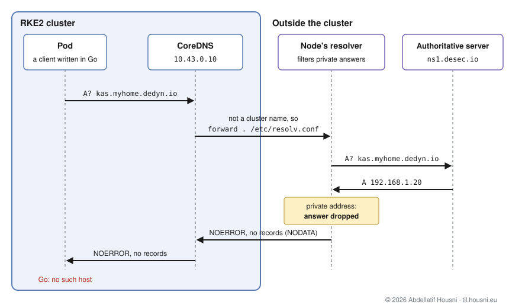

# `no such host` from a pod when the name resolves everywhere else: DNS rebinding protection

A pod in a homelab cluster logs this, while the same name works from a laptop:

```text
dial tcp: lookup kas.myhome.dedyn.io on 10.43.0.10:53: no such host
```

The record exists, the server that holds it answers, and other names in the same zone resolve from the same pod. The cause is that the name points at a private address, and the resolver the cluster uses refuses to pass that answer on. The filter sits outside Kubernetes, which is why nothing in the cluster looks wrong.

A few DNS words first:

- A *zone* is the set of names one party manages, such as `myhome.dedyn.io` and the names under it. A *record* is one entry in it: an `A` record maps a name to an IPv4 address.
- The *authoritative* server for a zone is the one that holds its records: the DNS host's own server.
- A *resolver* (or recursive resolver) is the server a machine asks for every name. It finds the authoritative server, asks it, and passes the answer back. The machine's resolvers are listed in `/etc/resolv.conf`.

The [cert-manager entry](../tls/cert-manager-dns-01-desec-private-kubernetes.md) runs into the same pair of servers from another side.

## Why a pod depends on the node's resolver

A *pod* is one or more containers that Kubernetes runs together, and a *Service* gives a set of pods one stable address ([the Kubernetes object model](../kubernetes/pods-deployments-services-object-model.md)). *CoreDNS* is the cluster's DNS server, and `10.43.0.10` is its Service address on RKE2 (the `cluster-dns` default in [RKE2's server configuration reference](https://docs.rke2.io/reference/server_config)). It answers cluster names itself and forwards everything else. Its configuration, the *Corefile*, says where:

```sh
kubectl -n kube-system get configmap rke2-coredns-rke2-coredns -o jsonpath='{.data.Corefile}' | grep forward
```

```text
    forward  . /etc/resolv.conf
```

So public names go to whichever resolvers the node has in `/etc/resolv.conf`. If those differ from your laptop's, a pod and a laptop can get different answers for the same name. See [what RKE2 is](../kubernetes/what-is-rke2-and-how-it-works.md) for how the cluster fits together.

<figure>

<figcaption>The record reaches the node's resolver intact. The resolver drops it on the way back, and CoreDNS only passes the empty answer along.</figcaption>
</figure>

## What DNS rebinding protection does

A homelab often publishes records holding private addresses: the name is public, but only machines on the LAN can reach the address. It's a common setup with [a Let's Encrypt certificate for a LAN-only service](../tls/caddy-dns-01-desec-dedyn-io.md).

*DNS rebinding* is an attack that uses the same shape: a site on the Internet gets a victim's browser to resolve the attacker's domain to a private address, then talks to devices on the victim's network. To stop it, some resolvers, routers and filtering services drop public answers that contain private addresses. NextDNS calls its setting [DNS Rebinding Protection](https://help.nextdns.io/t/35hmval/what-is-dns-rebinding-protection), off by default; pfSense has [its own](https://docs.netgate.com/pfsense/en/latest/services/dns/rebinding.html), and so does [Knot Resolver](https://knot.pages.nic.cz/knot-resolver/config-rebinding.html).

The answer isn't an error. The resolver replies `NOERROR` with no records, known as *NODATA*, and Go programs report that as `no such host`, the same as for a name that doesn't exist. The server's name in the message is CoreDNS, which only passed the empty answer along.

## Finding it

**1. Ask each resolver directly, starting at the source.** `dig` queries one server with `@`. deSEC's authoritative servers are `ns1.desec.io` and `ns2.desec.org`. `NODE_RESOLVER` stands for the address in the node's `/etc/resolv.conf`.

```sh
grep nameserver /etc/resolv.conf                 # on the node
dig +short @ns1.desec.io kas.myhome.dedyn.io A   # the record itself
dig +short @1.1.1.1 kas.myhome.dedyn.io A        # a resolver with no such filter
dig +short @NODE_RESOLVER kas.myhome.dedyn.io A  # what the cluster gets
```

An answer from the first two and an empty line from the last points at the node's resolver.

**2. Look at the status, which separates this from a missing record.**

```sh
dig @NODE_RESOLVER kas.myhome.dedyn.io A +noall +comments | grep -oE 'status: [A-Z]+|ANSWER: [0-9]+'
```

```text
status: NOERROR
ANSWER: 0
```

A name that doesn't exist answers `NXDOMAIN` instead.

**3. Prove the filter without touching your own zone.** [nip.io](https://nip.io) is a public service whose names resolve to the address they contain, so a private address and a public one can be compared:

```sh
for r in 1.1.1.1 NODE_RESOLVER; do
  for n in 192.168.1.20.nip.io 8.8.8.8.nip.io; do
    echo "$r $n: $(dig +short @$r $n A)"
  done
done
```

Through a resolver with the protection on:

| Name | `1.1.1.1` | Filtering resolver |
|---|---|---|
| `192.168.1.20.nip.io` | `192.168.1.20` | (empty) |
| `8.8.8.8.nip.io` | `8.8.8.8` | `8.8.8.8` |

Private address dropped, public one passed: that is the filter, whatever it's called in your resolver.

**4. Confirm from a pod.** A throwaway pod with `nslookup` (the curl image is built on Alpine, whose BusyBox has it) asks CoreDNS like any other pod:

```sh
kubectl run dnstest --rm -i --restart=Never --image=docker.io/curlimages/curl:8.23.0 \
  --command -- nslookup kas.myhome.dedyn.io
```

## Fixing it

| Fix | Scope | Trade-off |
|---|---|---|
| Add a rewrite at the resolver | One name | One entry per name. Tested below |
| Allow the domain or turn the protection off | The domain, or everything | Removes a protection the resolver is there to give. Not tested here |
| Point the node at another resolver | The whole node | Loses that resolver's filtering. Not tested here |
| Add the name to CoreDNS's `hosts` plugin | The cluster only | Another copy of the address to keep in sync. Not tested here |

A *rewrite* is a resolver setting that answers a name with a fixed address. NextDNS has one, and many filtering resolvers and routers have an equivalent. It's the resolver's own answer, so the filter doesn't apply. After adding one for `kas` and `minio`, both resolved from a pod, and the client that had been failing connected.

Pick whichever you like, but **a new name inherits the problem**. Adding the public record isn't enough for a pod to resolve it when the resolver filters it, and a name no pod uses can stay broken for a long time without anyone noticing.

## Sources

- Tested on 2026-10-31 on a single-node RKE2 v1.35 cluster whose node uses NextDNS, with the protection on: the `nip.io` table, the `NOERROR` and `ANSWER: 0` status, the failing lookup from a pod, and the rewrite fixing it, with the GitLab agent as the client. Names and addresses are placeholders, except `nip.io`.
- The NextDNS profile wasn't read, so that its DNS Rebinding Protection is the setting behind the filter is inferred from the behaviour above, not seen in the settings.
- Checked on 2026-11-17 in a cloud container: Go 1.24's resolver returns `no such host` (with `IsNotFound` set) for a `NOERROR` reply with no records, against a local test server; RKE2's `rke2-coredns` chart patches the Helm name so the ConfigMap is `rke2-coredns-rke2-coredns` ([rancher/rke2-charts](https://github.com/rancher/rke2-charts), `packages/rke2-coredns`), and the upstream CoreDNS chart's default `forward` is `. /etc/resolv.conf`; deSEC's nameservers are from [its documentation](https://desec.readthedocs.io/en/latest/dns/domains.html).
- The `dig` and `kubectl` commands ran on real lab hardware, not in the usual cloud container, which has no DNS access. The `nslookup` pod in step 4 wasn't run with this image tag, other resolvers' protections weren't tried, and the three other fixes weren't run.
