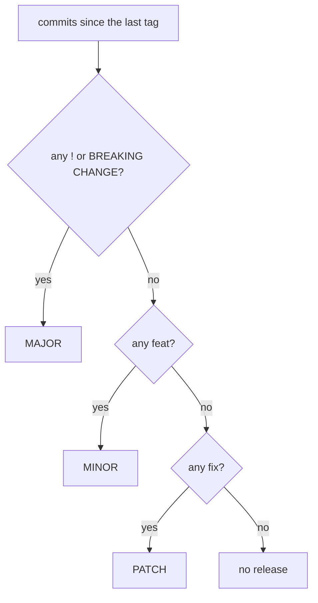

# Conventional Commits: commit messages that tools can read

[Conventional Commits](https://www.conventionalcommits.org/en/v1.0.0/) is a short specification (version 1.0.0) for the first line and footers of a commit message. A human reads `feat(rke2): add optional agent configuration` as "a new feature in the rke2 part"; a tool reads the same line and can decide the next version number, write a changelog, or reject the message in CI.

## The structure

```text
<type>[optional scope]: <description>

[optional body]

[optional footer(s)]
```

- **type**: what kind of change it is. The specification defines two, `feat` (a new feature) and `fix` (a bug fix), and allows others.
- **scope**: an optional noun in parentheses naming the part of the codebase, as in `fix(parser):`.
- **description**: a short summary right after the colon and space.
- **body**: optional free text, one blank line after the description, as many paragraphs as needed.
- **footers**: optional `token: value` lines one blank line after the body, such as `Refs: #123` or `Reviewed-by: Z`. Tokens use `-` instead of spaces, except `BREAKING CHANGE`.

## How it maps to versions

*Semantic versioning* (SemVer) numbers releases `MAJOR.MINOR.PATCH` ([explained here](../ansible/pinning-ansible-core-pip-tools-uv-poetry.md)). Conventional Commits is designed to line up with it:

| Commit | Meaning | SemVer bump |
|---|---|---|
| `fix: ...` | patches a bug | PATCH |
| `feat: ...` | adds a feature | MINOR |
| any type with `!` before the colon, or a `BREAKING CHANGE:` footer | breaks compatibility | MAJOR |
| `docs:`, `chore:`, `refactor:`, ... | everything else | none, unless it also has a breaking change |



A breaking change can be flagged either way, or both:

```text
refactor(postgresql)!: replace the legacy data-directory variable

BREAKING CHANGE: rename pg_data_path to postgresql_data_dir in the
inventory before upgrading this role.
```

`BREAKING CHANGE` must be upper case; `BREAKING-CHANGE` means the same. Everything else, types included, is case-insensitive.

## Which other types

The specification doesn't list them. It points to `@commitlint/config-conventional`, based on the Angular convention, which accepts `build`, `chore`, `ci`, `docs`, `feat`, `fix`, `perf`, `refactor`, `revert`, `style` and `test`.

## Checking messages with commitlint

*commitlint* is a Node.js tool that checks a message against a set of rules. With `@commitlint/cli` 21.2.4 and that shared config:

```bash
npm install --save-dev @commitlint/cli @commitlint/config-conventional
echo 'module.exports = { extends: ["@commitlint/config-conventional"] };' > commitlint.config.cjs
printf '%s\n' "feat(rke2)!: rename the agent config variable" | npx commitlint   # exit 0
printf '%s\n' "Fixed the ntp role" | npx commitlint
```

The last one fails:

```text
✖   subject may not be empty [subject-empty]
✖   type may not be empty [type-empty]
```

and `feature: add ntp role` fails with `type must be one of [build, chore, ci, docs, feat, fix, perf, refactor, revert, style, test]`. Run as a Git `commit-msg` hook or as a CI job, the same check stops the message before it lands.

## Points the FAQ settles

- **Before 1.0.0**: the specification recommends proceeding *"as if you've already released the product"*, since someone may already depend on it.
- **A wrong type**: before merging, rewrite it with `git rebase -i`. A type the tool doesn't know is simply ignored by it.
- **Not every contributor has to follow it**: with squash merging, whoever merges writes the final message, so only that message needs to conform.
- **Reverts** are not defined; tools handle them their own way, for example a `revert` type with a footer naming the reverted commits.

## Where it goes next

Release tools such as *semantic-release* read these messages since the last tag, compute the next version, create the tag and write release notes. That is the step that turns a convention into automatic versioning.
