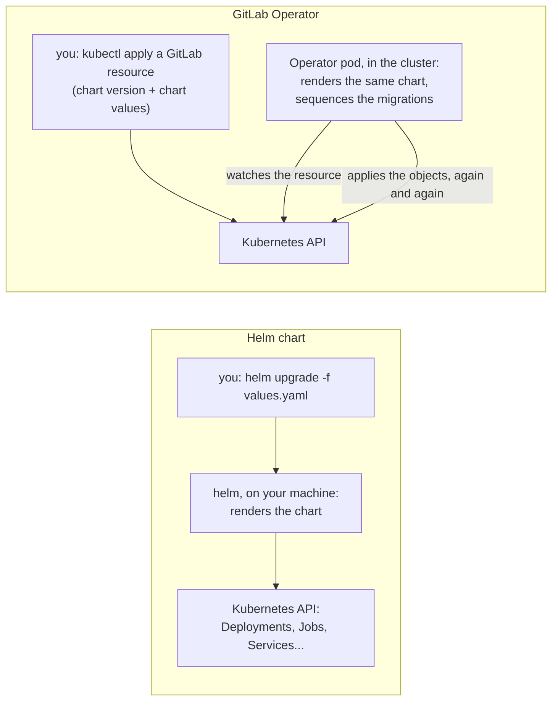

# GitLab on Kubernetes: the Helm chart or the GitLab Operator, and whether the Operator makes an upgrade easier

GitLab documents two ways to run itself on Kubernetes: the GitLab Helm chart, which you install and upgrade with the `helm` command, and the GitLab Operator, a controller in the cluster that installs and upgrades GitLab for you. This homelab runs GitLab with the Helm chart, on a single-node [RKE2](../kubernetes/what-is-rke2-and-how-it-works.md) cluster in a Hyper-V virtual machine, and that installation now has a hard upgrade ahead of it: from GitLab 18.11 to 19.4, across the 19.0 release that removes parts of the chart the lab still uses. This entry compares the two methods, then asks whether moving to the Operator would make that upgrade easier.

The short answer is no, not for this upgrade. The Operator renders the same chart, needs the same external services, and follows the same upgrade stops. It can't take over an existing Helm installation, and each Operator release accepts only three chart versions, so the upgrade would need more steps, not fewer.

Versions checked on 2026-11-25: GitLab Operator 3.6.1 (released 2026-11-20, runs charts 10.6.1, 10.5.9 and 10.4.11, that is GitLab 19.6.1, 19.5.8 and 19.4.10). The lab runs GitLab 18.11.12 from chart 9.11.13, on RKE2 v1.35.1 (Kubernetes 1.35).

## Terms this entry relies on

- **Helm**: in its own words, "the package manager for Kubernetes". A **chart** is a package of templated Kubernetes manifests. You install it with your own settings, the **values** (a `values.yaml` file), and each install is a **release** with numbered revisions that `helm upgrade` and `helm rollback` move between. Helm acts only when you run it.
- **Operator**: Kubernetes' documentation calls operators "software extensions to Kubernetes that make use of custom resources to manage applications and their components". A *custom resource* is a new object type added to the Kubernetes API, and the operator is a controller that watches it and keeps the cluster matching it. [The kube-prometheus entry](../kubernetes/kube-prometheus-on-rke2-step-by-step.md) installs one, and [the first entry of the RKE2 series](../kubernetes/what-is-kubernetes-and-how-it-works.md) explains the reconciliation loop controllers run on.
- **Linux package**: GitLab's current name for what is still often called *Omnibus GitLab*, the package (also shipped as the `gitlab/gitlab-ce` Docker image) that bundles every GitLab service on one machine and is configured with `/etc/gitlab/gitlab.rb`.
- **Webservice and Sidekiq**: the two GitLab components an upgrade restarts with care. Webservice runs the Rails application that serves the web interface and API; Sidekiq runs its background jobs.
- **Database migrations**: the schema changes a new GitLab version brings. The chart runs them in a Kubernetes Job. *Post-deployment migrations* are the part that may run only once the new code is running everywhere. *Batched background migrations* keep running inside GitLab after the upgrade, and the next upgrade has to wait until they finish.
- **Required upgrade stop**: a GitLab version you can't skip on the way up, because it carries migrations later versions rely on. GitLab's upgrade path page lists 18.2, 18.5, 18.8 and 18.11 in GitLab 18, and 19.2, 19.5, 19.8 and 19.11 in GitLab 19.
- **Zero-downtime upgrade**: GitLab's procedure that upgrades while users keep working, by running old and new pods side by side. **Maintenance mode** is GitLab's read-only switch, used during an upgrade with downtime.
- **Bundled services**: the PostgreSQL, Redis and MinIO (object storage) charts the GitLab chart could install alongside GitLab, for evaluation. Chart 10.0 (GitLab 19.0) removed them.
- **Toolbox and `backup-utility`**: the chart's Toolbox pod holds GitLab's maintenance tools; `backup-utility`, run in it, writes a backup archive to object storage. The **rails secret** (`db_key_base` and the other keys that encrypt data in the database) isn't in that archive and has to be saved apart.
- **Ingress controller** and **Gateway API**: what routes HTTP(S) traffic from outside into the cluster. [The RKE2 ingress entry](../kubernetes/rke2-ingress-traefik-nginx-retirement.md) explains the controllers and why ingress-nginx is ending. Gateway API is the newer Kubernetes API for the same job; *Envoy Gateway* is the implementation the GitLab chart now installs by default.
- **cert-manager**: the controller that requests and renews TLS certificates inside a cluster; [the cert-manager entry](../tls/cert-manager-dns-01-desec-private-kubernetes.md) sets it up for this lab.

## How each one works

The Operator doesn't replace the chart. Its own design record, ADR 4 of the Operator repository, says it renders the GitLab chart with the values from its custom resource "to create a template similar to the output of `helm template`", and draws the consequence: "the Operator is effectively a wrapper around the GitLab chart". So the same chart values configure both; what changes is who applies them, and when.

With the Operator, an upgrade is a one-line change of `spec.chart.version` in the `GitLab` resource (API group `apps.gitlab.com/v1beta1`), followed by `kubectl apply`. The Operator then runs the zero-downtime sequence itself: it updates the Webservice and Sidekiq Deployments but keeps them paused, runs the migrations Job without the post-deployment migrations, resumes the Deployments, waits for the new pods, runs the post-deployment migrations, then restarts Webservice and Sidekiq once more. With Helm, a zero-downtime upgrade is the same sequence done by hand: pause the Deployments, `helm upgrade` with `SKIP_POST_DEPLOYMENT_MIGRATIONS=true`, resume them, then `helm upgrade` again.

## Side by side

| | Helm chart | GitLab Operator |
|---|---|---|
| What you write | `values.yaml` | a `GitLab` resource: the chart version, and the same values under `spec.chart.values` |
| What applies it | `helm`, when you run it | the Operator's controller, continuously |
| What you install first | the `helm` client | the Operator (manifest, Helm chart or, on OpenShift, OLM), plus cert-manager beforehand for its webhook certificate, and metrics-server for the autoscalers |
| Which GitLab versions | any chart version; the version mapping page gives the GitLab version of each | the three chart versions listed in the Operator release's `CHART_VERSIONS` file |
| Upgrading | `helm upgrade -f values.yaml`, never `--reuse-values`; you choose and sequence zero downtime or downtime | change `spec.chart.version`; zero downtime by default, one minor version at a time; the annotation `gitlab.io/disable-zero-downtime-upgrade: "true"` for an upgrade with downtime (Operator 3.0.0 and later, "GitLab 19.0 and later") |
| Upgrade stops | yours to follow | the Operator enforces a valid path since 2.6.0 and 2.5.1; with downtime the stops are still yours |
| PostgreSQL, Redis, object storage | bundled charts until 9.x (GitLab 18), external from 10.0 (GitLab 19) | external, the documentation says, for every release; its reconciliation code for the bundled ones left in 3.3.0 |
| Backups | `backup-utility` in the Toolbox pod | the same Toolbox and `backup-utility` |
| Kubernetes releases | 1.35 to 1.37 supported (1.37 from GitLab 19.5); chart 10.6.0 and later refuse anything before 1.30 | 1.35 to 1.37 supported, plus OpenShift 4.21 and 4.22 |

The Operator's own pages add a warning the chart's don't carry: it "has known limitations and is only suitable for specific scenarios in production use", and "any limitation in GitLab chart impacts GitLab Operator".

## What this lab chose

The lab's plan listed six ways to run GitLab, from gitlab.com to `helm template` piped into `podman kube play`, and kept two: the Linux package in a container on Podman, matching the Docker-image install it was built to mirror, and the Helm chart on a single-node RKE2 cluster for the Kubernetes side. The Operator wasn't among the options. The chart side is the one that runs, since 2026-10-15, on a Hyper-V virtual machine with RHEL 10, one replica of every GitLab component, the chart's bundled PostgreSQL 16.6.0, Redis and MinIO, and the chart's own NGINX Ingress controller. The Linux package side is written but hasn't run yet.

## Would the Operator help upgrade the Hyper-V installation?

The lab's way up has three phases: move PostgreSQL, Redis and object storage out of the chart while still on 18.11 (GitLab's bundled chart migration guide does this by backup and restore, with downtime), move ingress from the chart's NGINX to RKE2's Traefik, then upgrade 18.11 → 19.2 → 19.4 with downtime, since one replica of everything can't give zero downtime anyway. GitLab's chart upgrade page lists "a multi-node GitLab Helm chart deployment with multiple replicas configured for Webservice and Sidekiq" as a requirement for it.

Here is what the Operator changes in that plan.

**It can't adopt the existing release.** The first known issue on the Operator's documentation page is that it doesn't support "managing existing Helm chart-based instances". Its backup page gives the way across instead: "you can create … new Operator-based instances from Helm chart-based instance backups". That is a new GitLab instance, installed by the Operator at the same GitLab version, and a restore of the backup and the rails secret into it. The Operator repository also documents `kubectl bridge migrate --from-helm`, which takes over a Helm release in place, but it belongs to *Bridge*, a web interface and API that GitLab marks as an experiment: "No Operator release contains Bridge yet." It also needs a release on chart 10.5.0 or later with no bundled Ingress controller. The lab is on 9.11.

**It doesn't remove the 19.0 work.** The Operator requires external PostgreSQL, Redis and object storage, and an Ingress or Gateway API controller, as the chart does from 19.0. The first two phases of the lab's plan would be needed before an Operator instance could even start, so the hardest part of the upgrade stays.

**It adds hops between versions.** Each Operator release runs three chart minor versions, and a newer Operator stops reconciling a resource whose chart version it doesn't list ("chart version … not supported; please use one of the following"). So the Operator version and the chart version climb in turns. From the release notes:

| Operator | Chart versions it runs (GitLab) |
|---|---|
| 3.1.6 | 9.11.16 (18.11.14), 10.0.11 (19.0.11), 10.1.10 (19.1.10) |
| 3.3.3 | 10.1.10 (19.1.10), 10.2.10 (19.2.10), 10.3.9 (19.3.7) |
| 3.4.3 | 10.2.10 (19.2.10), 10.3.9 (19.3.7), 10.4.6 (19.4.5) |

With Helm, 18.11 → 19.2 → 19.4 is two `helm upgrade` runs. With the Operator it is at least three Operator upgrades and three chart changes, and with its default zero-downtime mode every minor version on the way: 19.0, 19.1, 19.2, 19.3, 19.4. The downtime annotation skips minor versions, but its documentation states it for GitLab 19.0 and later, so whether it applies to the jump out of 18.11 isn't said.

**What it would automate is a part this lab doesn't use.** The sequencing it does for you is the zero-downtime one. An upgrade with downtime, the lab's choice, is one `helm upgrade` with `gitlab.migrations.enabled=true` in the chart's own procedure.

**Where it would start to help.** Bridge's documentation describes the parts that would: *upgrade channels*, with which "the Operator upgrades it one minor version at a time, without downtime" and waits "until the batched background migrations of the current one are done" before the next one, and an in-place migration from a Helm release that keeps the Gitaly volumes, the generated Secrets and the external services. Both target the `apps.gitlab.com/v2alpha1` resources, and both are an experiment for now. The lab's plan ends on chart 10.x with external services and no bundled Ingress controller, which is what that migration asks for.

## And the Linux package installation?

Neither Kubernetes method upgrades a Linux package installation: moving one to Kubernetes is a migration, and GitLab documents it for the chart. The chart has to run the same GitLab version, with external PostgreSQL, Redis and object storage already in place. The package's uploads, artifacts and other files move to object storage first, then a backup excluding them is restored with `backup-utility`, and the secrets move from `/etc/gitlab/gitlab-secrets.json` to the chart's YAML Secret (`yq -P '{"production": .gitlab_rails}' gitlab-secrets.json`). An Operator instance uses the same Toolbox, so the same backup and restore apply to it.

## Sources

GitLab Operator documentation, read on 2026-11-25 from its source in [the Operator repository](https://gitlab.com/gitlab-org/cloud-native/gitlab-operator/-/tree/master/doc), because docs.gitlab.com couldn't be reached from the session: [overview and known issues](https://docs.gitlab.com/operator/), [installation](https://docs.gitlab.com/operator/installation/), [upgrading GitLab with the Operator](https://docs.gitlab.com/operator/gitlab_upgrades/), [backup and restore](https://docs.gitlab.com/operator/backup_and_restore/), and the Bridge pages [`bridge/_index.md`](https://gitlab.com/gitlab-org/cloud-native/gitlab-operator/-/blob/master/doc/bridge/_index.md) and [`bridge/migrate-from-helm.md`](https://gitlab.com/gitlab-org/cloud-native/gitlab-operator/-/blob/master/doc/bridge/migrate-from-helm.md); the design records [ADR 4](https://gitlab.com/gitlab-org/cloud-native/gitlab-operator/-/blob/master/doc/developer/adr/0004-integration-of-the-gitlab-chart.md) and [ADR 6](https://gitlab.com/gitlab-org/cloud-native/gitlab-operator/-/blob/master/doc/developer/adr/0006-gitlab-application-versions-supported.md); the [releases](https://gitlab.com/gitlab-org/cloud-native/gitlab-operator/-/releases), their version mappings and the [changelog](https://gitlab.com/gitlab-org/cloud-native/gitlab-operator/-/blob/master/CHANGELOG.md).

GitLab chart and GitLab documentation, read the same way from [the chart repository](https://gitlab.com/gitlab-org/charts/gitlab/-/tree/master/doc) and [the GitLab repository](https://gitlab.com/gitlab-org/gitlab/-/tree/master/doc): [upgrading the chart](https://docs.gitlab.com/charts/installation/upgrade/), [cluster requirements and supported Kubernetes releases](https://docs.gitlab.com/charts/installation/cloud/), [version mappings](https://docs.gitlab.com/charts/installation/version_mappings/), [migrating from the bundled Redis, PostgreSQL and MinIO](https://docs.gitlab.com/charts/installation/migration/bundled_chart_migration/), [migrating from the Linux package](https://docs.gitlab.com/charts/installation/migration/package_to_helm/), [restoring](https://docs.gitlab.com/charts/backup-restore/restore/) and [upgrade paths](https://docs.gitlab.com/update/upgrade_paths/).

Kubernetes' [operator pattern](https://kubernetes.io/docs/concepts/extend-kubernetes/operator/) page and Helm's [introduction](https://helm.sh/docs/intro/introduction/), read from their sources in kubernetes/website and helm/helm-www on GitHub, since neither site could be reached either.

The commands in this entry ran nowhere for it: the Operator wasn't installed, and the cloud container this entry was written in can't run Kubernetes. The lab's versions, values and plan come from the owner's runs on the Hyper-V virtual machine (RHEL 10, RKE2 v1.35.1).
