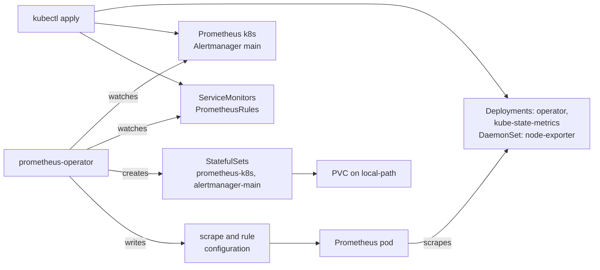

# Installing kube-prometheus on RKE2, one step at a time

[kube-prometheus](https://github.com/prometheus-operator/kube-prometheus) is a set of Kubernetes manifests for a complete monitoring stack: Prometheus, Alertmanager, the exporters that feed them, and the alert rules that go with them. Its README installs it with two `kubectl apply` commands, and the homelab wraps those in a script. This entry runs the same steps one at a time instead, on an [RKE2](what-is-rke2-and-how-it-works.md) v1.37.2 cluster of three nodes (one server, two agents), to see what each one does. The release is v0.19.0, the only one whose compatibility table lists Kubernetes 1.37 (it covers 1.35 to 1.37).

## The pieces

*Prometheus* collects metrics by *scraping*: on a schedule (every 30 seconds for most targets here), it reads an HTTP page of numbers (`/metrics`) from each *target*, and keeps them as time series. It also evaluates *rules*: recording rules that precompute queries, and alert rules that fire when a query returns something. *Alertmanager* receives the fired alerts, groups them and routes them to receivers such as email or chat. An *exporter* is a small program that publishes another system's numbers as such a page.

kube-prometheus doesn't configure Prometheus with its configuration file. It installs the *Prometheus Operator*, a controller that adds new object types to the Kubernetes API through custom resource definitions (CRDs: see [the upgrade entry](rke2-upgrade-with-the-lablabs-rke2-role.md#what-the-role-doesnt-look-at-the-packaged-charts)), and builds Prometheus from them:

| CRD | What you declare with it |
|---|---|
| `Prometheus`, `Alertmanager` | a server: replicas, retention, storage. The operator creates the pods. |
| `ServiceMonitor`, `PodMonitor`, `Probe`, `ScrapeConfig` | what to scrape, selected by labels |
| `PrometheusRule` | recording and alert rules |
| `AlertmanagerConfig` | alert routing, per namespace |
| `PrometheusAgent`, `ThanosRuler` | variants this stack doesn't use |

The release's other files are grouped by component:

| Component | What it runs |
|---|---|
| `prometheusOperator` | the operator |
| `prometheus`, `alertmanager` | one `Prometheus` object, `k8s`, and one `Alertmanager`, `main` |
| `nodeExporter` | one pod per node: the node's CPU, memory, disks and network |
| `kubeStateMetrics` | the state of the objects in the API: replicas wanted and ready, pod phases, restarts |
| `kubernetesControlPlane` | `ServiceMonitor`s for the API server, the kubelet (which includes cAdvisor, the per-container metrics), CoreDNS, the scheduler and the controller manager, with their rules |
| `kubePrometheus` | general rules |
| `prometheusAdapter` | serves `kubectl top` from Prometheus |
| `blackboxExporter` | probes HTTP and TCP endpoints from the outside |
| `grafana` | dashboards |

This cluster gets a trimmed version: no Grafana, no prometheus-adapter (RKE2's own metrics-server already serves `kubectl top`), no blackbox-exporter, nothing for the scheduler, controller manager and CoreDNS (on RKE2 they listen on `127.0.0.1` or have no metrics port, so the targets would stay down), and one replica each of Prometheus and Alertmanager. The trimming is a Kustomize overlay, explained in [the Kustomize entry](kustomize-overlays-trimming-an-upstream-release.md).

## Step 0: what the cluster has already

```bash
kubectl get storageclass
kubectl top nodes
kubectl describe nodes | grep -A7 'Allocated resources'
```

- `local-path` is the default [StorageClass](rke2-no-default-storageclass.md), with `WaitForFirstConsumer`: a volume is created on whichever node its pod lands on. Prometheus's data goes there.
- `kubectl top` comes from metrics-server, which keeps only the latest value. Prometheus keeps history.
- The CPU *requests* (what pods have reserved) were already 37 to 60% of each node. The trimmed stack requests about 0.5 CPU and 1.5 GiB in total.

`kubectl get pods -A | grep -vE 'Running|Completed'` should print only its header line. Here it first showed Longhorn's pods starting, because Longhorn was being upgraded at the same moment: worth waiting for, so that the stack's own pods are the only new ones.

## Step 1: the release, and what the overlay keeps

```bash
work=$(mktemp -d)
mkdir "$work/upstream"
curl -fsSL https://github.com/prometheus-operator/kube-prometheus/archive/refs/tags/v0.19.0.tar.gz |
  tar -xz -C "$work/upstream" --strip-components=1
cp -r my-overlay "$work/overlay"   # its kustomization.yaml is in the Kustomize entry

kubectl kustomize "$work/upstream" | grep -c '^kind:'    # 131
kubectl kustomize "$work/overlay"  | grep -c '^kind:'    # 62
```

`kubectl kustomize` renders without contacting the cluster. The release as published is 131 objects; the overlay leaves 62. `manifests/setup/` holds the ten CRDs and the `monitoring` namespace, which have to exist before anything else.

## Step 2: the CRDs, server-side

```bash
kubectl apply --server-side -f "$work/upstream/manifests/setup"
kubectl wait --for=condition=Established --all crd --timeout=60s
```

**Why `--server-side`.** A plain `kubectl apply` stores a copy of each object in its `kubectl.kubernetes.io/last-applied-configuration` annotation, to compute the next change. The `Prometheus` CRD file is 834,604 bytes, and annotations are limited to 262,144. Without `--server-side`, on a k3s v1.35.4 API server:

```
The CustomResourceDefinition "prometheuses.monitoring.coreos.com" is invalid: metadata.annotations: Too long: may not be more than 262144 bytes
```

*Server-side apply* has the API server merge the change and record which *field manager* (here `kubectl`) owns which fields, in `metadata.managedFields`, with no copy in an annotation. `Established` means the API server serves the new types. Until then, applying a `Prometheus` object fails: on the k3s API server, with `the server could not find the requested resource`.

**What went wrong first.** On this cluster, the first apply failed on every CRD:

```
Apply failed with 3 conflicts: conflicts with "helm":
- .metadata.annotations.controller-gen.kubebuilder.io/version
- .metadata.annotations.operator.prometheus.io/version
- .spec.versions
```

The CRDs already existed. Earlier that day, the kube-prometheus-stack Helm chart (another packaging of the same operator) had been installed and uninstalled. `helm list -A` showed no release left and no monitoring pod ran, but the CRDs were still there, at operator 0.95.1 against 0.94.1 in kube-prometheus v0.19.0. Helm installs a chart's CRDs and never removes them: its documentation says "There is no support at this time for upgrading or deleting CRDs using Helm", to avoid deleting data by accident. The field manager `helm` is the name Helm gave its own apply.

`--force-conflicts` would have taken the fields over. With no release left to want them back, the cleaner way out was to delete the leftovers, after checking that no object of those types existed, since deleting a CRD deletes every object of its type:

```bash
for r in $(kubectl get crd -o name | grep monitoring.coreos.com | cut -d/ -f2); do
  printf '%-45s %s\n' "$r" "$(kubectl get "$r" -A --no-headers 2>/dev/null | wc -l)"
done                                                  # every count 0
kubectl get crd -o name | grep monitoring.coreos.com | xargs kubectl delete
```

Then the same `apply --server-side` went through. A conflict only shows when the two versions differ: on the k3s API server, CRDs applied by a manager named `helm` and then applied again unchanged by `kubectl` raised nothing, and both managers were recorded as owners. The homelab's script now checks `managedFields` instead, and stops when any monitoring CRD has a manager other than `kubectl`.

## Step 3: everything else

```bash
kubectl apply --server-side --dry-run=server -k "$work/overlay" | grep -v 'serverside-applied (server dry run)'   # nothing
kubectl apply --server-side -k "$work/overlay"
```

Now that the types exist, `--dry-run=server` has the API server validate all 62 objects without storing them. The real apply reported 62 times `serverside-applied` (the CRDs again, unchanged, since the overlay includes them).

## Step 4: the operator builds the rest



```bash
kubectl -n monitoring rollout status deploy/prometheus-operator --timeout=5m
kubectl -n monitoring wait --for=condition=Available prometheus/k8s --timeout=5m
kubectl -n monitoring wait --for=condition=Available alertmanager/main --timeout=5m
kubectl -n monitoring get prometheus,alertmanager,sts,pvc
kubectl -n monitoring get pods -o wide
```

What was applied directly appeared at once: the operator and kube-state-metrics *Deployments*, and node-exporter as a *DaemonSet*, one pod per node. The two *StatefulSets* (a Deployment's counterpart for pods that need a stable name and their own volume) weren't in the 62 objects: the operator created them about 20 seconds later, once it had started and read the `Prometheus` and `Alertmanager` objects. Both reported `Reconciled` and `Available` about 80 seconds after the apply, running Prometheus 3.14.0 and Alertmanager 0.34.1.

The `Prometheus` object selects with empty selectors (`serviceMonitorSelector: {}`, `serviceMonitorNamespaceSelector: {}`, the same for rules), so it picks up every `ServiceMonitor` and `PrometheusRule` in every namespace. Adding a scrape target later is adding a `ServiceMonitor`, wherever it lives.

A few details from the pod list:

- **The containers.** kube-state-metrics has 3, node-exporter and the operator 2: each metrics port sits behind a `kube-rbac-proxy` sidecar, which lets a scrape through only if the caller's *ServiceAccount* (the identity a pod presents to the API) is allowed to read metrics by RBAC.
- **node-exporter's addresses.** Its pods have the nodes' own IP addresses, `192.168.1.x`, not pod addresses: they run with `hostNetwork`, to see the host's network interfaces rather than a container's.
- **Prometheus's volume.** The *PersistentVolumeClaim* `prometheus-k8s-db-prometheus-k8s-0` waited, as `WaitForFirstConsumer` intends, until the scheduler placed `prometheus-k8s-0` on `rke2-agent-1`; the provisioner then created the volume there. Its reclaim policy is `Delete`: deleting the claim deletes the data. local-path doesn't enforce the 4Gi size either, its README says "No support for the volume capacity limit currently", which is why the overlay sets `retentionSize: 2GB` next to `retention: 7d`: Prometheus deletes old data when either is reached.

## Step 5: targets and alerts

Prometheus has a cluster-internal Service only, and a [NetworkPolicy](rke2-cni-canal-and-alternatives.md) that admits only pods labelled `prometheus`, `prometheus-adapter` or `grafana` in its own namespace. `kubectl port-forward` opens a tunnel from the workstation to the pod, through the API server and the kubelet, and it reached Prometheus despite that policy:

```bash
kubectl -n monitoring port-forward svc/prometheus-k8s 9090 >/dev/null 2>&1 &

curl -s localhost:9090/api/v1/targets |
  jq -r '.data.activeTargets[] | "\(.labels.job)\t\(.health)"' | sort | uniq -c
curl -s localhost:9090/api/v1/alerts |
  jq -r '.data.alerts[] | select(.state == "firing") | "\(.labels.alertname)\t\(.labels.severity)"'
```

The same pages are at `http://localhost:9090/targets` and `/alerts` in a browser. Two alerts fired, both with `severity: none`, and both on purpose:

- **`Watchdog`** always fires. If it stops reaching Alertmanager, the alerting pipeline itself is broken.
- **`InfoInhibitor`** exists to keep `info` alerts quiet. Its rule's description: it "fires whenever there's a severity="info" alert, and stops firing when another alert with a severity of 'warning' or 'critical' starts firing on the same namespace", and "should be routed to a null receiver and configured to inhibit alerts with severity="info"". Its expression counts `info` alerts that are still pending (true, but not yet for long enough to fire), so it can fire while the firing list shows no `info` alert.

Alertmanager's configuration has four receivers, `Default`, `Watchdog`, `Critical` and `null`, none with a destination: alerts are visible in its UI, and go nowhere else.

## Step 6: where the numbers come from

```bash
q() { curl -s localhost:9090/api/v1/query --data-urlencode "query=$1" |
      jq -r '.data.result[] | "\(.metric | del(.__name__) | to_entries | map(.value) | join(" "))\t\(.value[1])"'; }

q '100 * (1 - node_memory_MemAvailable_bytes / node_memory_MemTotal_bytes)'                  # node-exporter
q 'sort_desc(sum by (namespace) (rate(container_cpu_usage_seconds_total{container!=""}[5m])))'  # cAdvisor
q 'sum by (namespace, pod) (increase(kube_pod_container_status_restarts_total[1h])) > 0'      # kube-state-metrics
q 'prometheus_tsdb_storage_blocks_bytes + prometheus_tsdb_wal_storage_size_bytes'            # Prometheus itself
```

- Memory in use per node came out at 22 to 30%, while `kubectl top nodes` showed 40 to 50% shortly after. The two aren't the same measure: metrics-server reports the *working set*, which the [resource metrics pipeline page](https://kubernetes.io/docs/tasks/debug/debug-cluster/resource-metrics-pipeline/) describes as an estimate that "generally makes heavy use of heuristics", while this query uses what the kernel reports as available.
- CPU per namespace put `kube-system` first (0.19 cores), then `longhorn-system`, then `monitoring` itself (0.03). `rate(...[5m])` turns a counter of CPU-seconds into cores in use, averaged over five minutes.
- The restarts query returned nothing, although Longhorn's CSI pods had restarted a few times during its upgrade that same hour. Prometheus had started a few minutes earlier: it knows only what happened after its first scrape.
- Prometheus's own data took 5.2 MB after a few minutes, against `retentionSize: 2GB`.

## What this setup doesn't do

No Grafana runs on this cluster, and the homelab's Grafana, on another cluster, can't reach this Prometheus: it has no external Service, its NetworkPolicy admits only a few pods of its own namespace, it has no authentication of its own, and the cluster has no ingress controller. Connecting them would mean exposing it behind authentication, pushing its samples to the other cluster's Prometheus (*remote write*), or running a second Grafana.

The commands ran on the Proxmox RKE2 cluster, run by the owner from a workstation. The renders, the CRD size error and the field-manager behaviour were reproduced in a Linux cloud container, against a k3s v1.35.4 API server.

## Sources

- kube-prometheus v0.19.0: [README](https://github.com/prometheus-operator/kube-prometheus/blob/v0.19.0/README.md) (compatibility table, the quickstart's `--server-side`), [`manifests/`](https://github.com/prometheus-operator/kube-prometheus/tree/v0.19.0/manifests) (the components, the `Prometheus` object's selectors, the `InfoInhibitor` rule in `kubePrometheus-prometheusRule.yaml`).
- [Prometheus Operator documentation](https://prometheus-operator.dev/docs/getting-started/introduction/).
- Helm: [Custom Resource Definitions](https://helm.sh/docs/chart_best_practices/custom_resource_definitions/) (CRDs are never upgraded or deleted).
- Kubernetes: [Server-Side Apply](https://kubernetes.io/docs/reference/using-api/server-side-apply/) (field managers, conflicts), [Resource metrics pipeline](https://kubernetes.io/docs/tasks/debug/debug-cluster/resource-metrics-pipeline/) (working set).
- local-path-provisioner v0.0.37: [README](https://github.com/rancher/local-path-provisioner/blob/v0.0.37/README.md) (no capacity limit).
