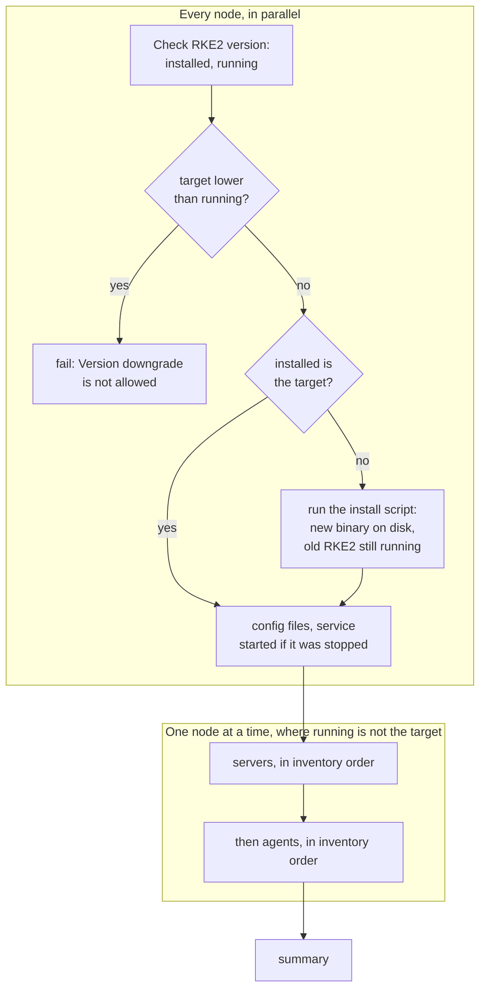
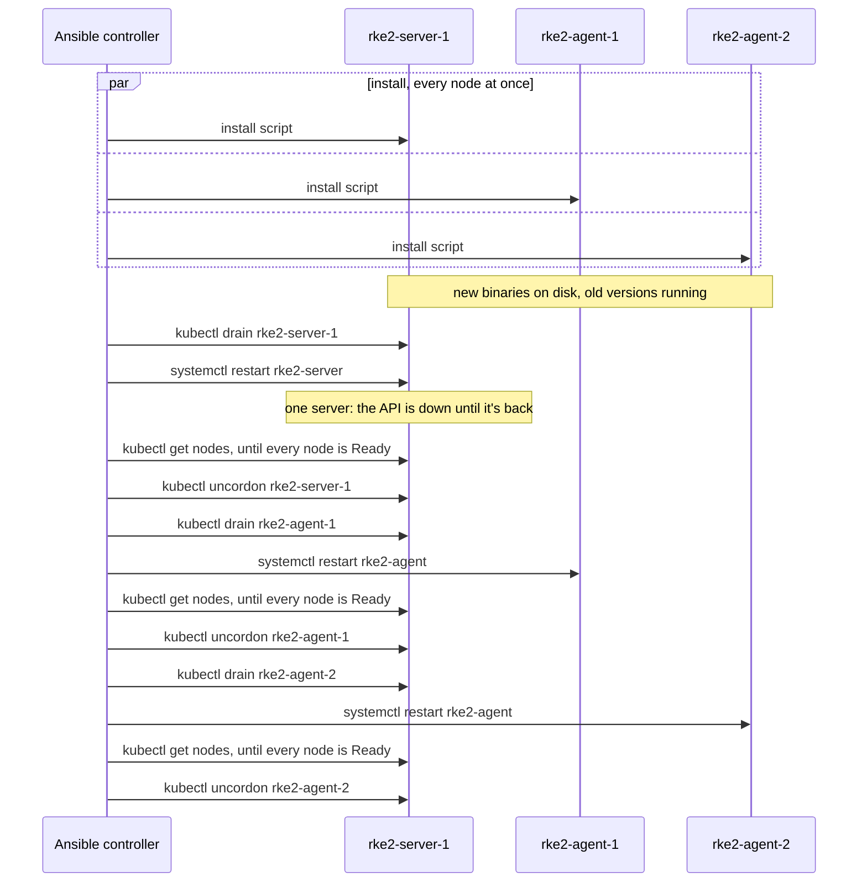

# How the lablabs.rke2 Ansible role upgrades an RKE2 cluster, node by node

Sixteenth entry in the RKE2/Kubernetes series. It comes from upgrading the series' Proxmox cluster (one server, two agents) from v1.30.6 to v1.37.2 on 2026-11-08, one minor version at a time. The cluster is installed by [lablabs.rke2](https://github.com/lablabs/ansible-role-rke2), an Ansible *role*: a packaged set of tasks, defaults and templates that a playbook applies to the hosts of an inventory. Changing its `rke2_version` variable and running the playbook again is the whole upgrade. This entry reads what the role does then, in version 1.54.0, and what it leaves to you.

[RKE2](what-is-rke2-and-how-it-works.md) is a Kubernetes distribution. A *server* runs the control plane (the API server, etcd, the scheduler) and an *agent* runs only workloads. An RKE2 version is a Kubernetes version plus an RKE2 release number: `v1.35.10+rke2r1` is Kubernetes 1.35.10.

## One minor at a time is your job

[RKE2's manual upgrade page](https://docs.rke2.io/upgrades/manual) says to upgrade the servers first, one at a time, then the agents, and that the Kubernetes [version skew policy](https://kubernetes.io/releases/version-skew-policy/) applies: don't skip a minor version. It adds: "Nothing in the upgrade process will protect against unsupported changes to the Kubernetes version." The role doesn't either. It compares versions only to refuse a downgrade, so going from 1.30 to 1.37 in one run is something it would attempt. To 1.37 from 1.30 is seven runs: 1.31, 1.32, and so on, each one checked before the next. [The Renovate entry](../renovate/adding-renovate-to-a-github-project.md#kubernetes-minors-one-at-a-time) shows how to get those versions proposed one minor per pull request.

## Two versions per node

Before changing anything, the role's `Check RKE2 version` task reads two versions on every node:

- **installed**: what the `rke2` binary on disk prints with `--version`, or `not installed`;
- **running**: what the binary of the running service prints. The task finds it through the service's main process, `/proc/<pid>/exe`.

Everything else follows from comparing the target `rke2_version` with these two:

- where **installed** isn't the target, it runs RKE2's install script, which replaces the binary but doesn't restart anything;
- where **running** isn't the target, it restarts the node;
- where both match, it does nothing, so a second run on a finished upgrade changes nothing.

## The whole run

The play applies the role to every server and agent, and Ansible runs a task on all hosts at once before moving to the next. So the install happens everywhere in parallel, and only the restarts are spread out:



The one-at-a-time part comes from how the role loops. `main.yml` includes `rolling_restart.yml` once per server, then once per agent, each time with a `when:` that only the matching host passes:

```yaml
- name: Rolling cordon and drain restart when version changes - servers
  ansible.builtin.include_tasks: rolling_restart.yml
  with_items: "{{ groups[rke2_servers_group_name] }}"
  loop_control:
    loop_var: _host_item
  when:
    - hostvars[_host_item].inventory_hostname == inventory_hostname
    - installed_version is defined
    - installed_version != "not installed"
    - rke2_version is defined
    - rke2_version != running_version
```

Each include then runs on one host, and Ansible finishes one include before starting the next. A copy of this pattern with three local hosts on ansible-core 2.22.0 ran the install on all three within the same tenth of a second, and each restart only after the previous one ended, the server's first.

## What one node's turn does

`rolling_restart.yml` is the same for a server and an agent. Its `kubectl` commands don't run on the node being restarted: they're delegated to the active server (`delegate_to`, which runs a task on another host than the one the play is on) and run once, with the server's own kubeconfig. For this cluster, with the drain switched on:



Only the restart and the wait for Ready nodes always happen. The rest depends on variables that are all `false` in the role's defaults:

| Variable | With `true` |
|---|---|
| `rke2_drain_node_during_upgrade` | cordons and drains the node before its restart, and uncordons it after |
| `rke2_reboot_node_after_upgrade` | reboots the node instead of restarting the service, and drains it too |
| `rke2_wait_for_all_pods_to_be_ready` | after the uncordon, waits until no pod in the cluster is outside `Running` or `Succeeded` |
| `rke2_wait_for_all_pods_to_be_healthy` | then waits for every pod outside `kube-system` to pass its readiness check |
| `rke2_allow_downgrade` | lets a lower `rke2_version` through the downgrade check |

Each wait retries 100 times, 15 seconds apart, so up to 25 minutes per node. [The maintenance entry](rke2-node-maintenance-drain-reboot.md) explains drain and cordon, and how a PodDisruptionBudget can keep a drain waiting.

**Without a drain, the pods keep running through the restart.** RKE2's systemd units use `KillMode=process`, and their `ExecStopPost` kills only the `containerd` and `kubelet` processes, so the containers' own processes survive a `systemctl restart`. A drain moves them to other nodes before the restart instead.

**Pass the switches as JSON.** `-e rke2_drain_node_during_upgrade=true` sets the string `"true"`, and ansible-core 2.19 and later refuse a string in a `when:`: the run stopped at "Cordon and Drain the node" with "Conditionals must have a boolean result". `-e '{"rke2_drain_node_during_upgrade": true}'` keeps the boolean. [The forcing-types entry](../ansible/forcing-types-extra-vars-conditionals.md) explains why.

**The run ends before the pods are back.** With the pod waits off, the role stops waiting once every node is Ready. After the 1.31 step, Canal (the network plugin), CoreDNS and Longhorn's driver deployer stayed in their init containers or `ContainerCreating` for about three minutes while the nodes pulled the new images, and then all ran. So the step is done when this prints only its header line:

```bash
kubectl get pods -A | grep -vE 'Running|Completed'
```

## A run that stops between the two phases

The first upgrade run here failed at the drain, after the install had already run on every node. Each node then ran the old RKE2 from a binary that had been replaced. Linux shows the executable of such a process with ` (deleted)` appended to its path, so the version check finds no file there and sets **running** to `outdated`. The next run then failed in the downgrade check:

```
Version parameter to compare against cannot be empty
```

The check extracts `vX.Y.Z` from the running version to compare it, and `outdated` has none. The role skips this check when `rke2_allow_downgrade` is a boolean `true`, but that also turns off the protection the check is for. With the new binaries already installed, the way out here was to do the second phase by hand, in the role's order: drain the server, `systemctl restart rke2-server` on it, wait for every node to be Ready, uncordon, then the same for each agent with `rke2-agent`. Once every node ran the target, the role read a real running version again, and the next step went through it normally.

## A role default that RKE2 1.37 refuses

The step to 1.37 failed at "Restart RKE2 service on rke2-server-1". The server's journal would have said why, and RKE2's source at v1.37.2+rke2r1 does too (`pkg/cli/cmds/server.go`):

```
ingress-nginx is no longer supported as a standalone ingress controller, please use traefik.
```

The cluster runs no ingress controller: its `rke2_disable` list turns off the `rke2-ingress-nginx` chart. But the role still writes its default, `rke2_ingress_controller: ingress-nginx`, into the server's `config.yaml`, and from 1.37 RKE2 exits at start when that is the only value. 1.36.6 has no such check, so the step before went through. Setting `rke2_ingress_controller: none` keeps the cluster as it was. RKE2 1.37 accepts `none` or `traefik`, plus `ingress-nginx` only next to traefik while migrating away from it: see [the ingress entry](rke2-ingress-traefik-nginx-retirement.md).

That failure also showed what the role does when a server doesn't come back. Ansible dropped the server from the run and went on to the agents. The first agent was drained, and its restart never ended: RKE2's units are `Type=notify` with `TimeoutStartSec=0`, so systemd waits for the start with no time limit, and the agent didn't finish starting without its server. Ctrl+C stopped the run, with 1.37 installed on every node:

| Node | State left |
|---|---|
| server | stopped, cordoned |
| first agent | starting, cordoned |
| second agent | still running 1.36 from a replaced binary, so `outdated` |

Rerunning the playbook with the setting, limited to the server and the first agent, started the server with the new `config.yaml`, and the first agent joined it. Both stayed cordoned, though. The role's uncordon is part of its restart, which it skips on a node that already runs the target. While the only server stayed cordoned, the Canal and CoreDNS install jobs stayed `Pending`: RKE2 installs them as bootstrap charts, whose jobs run only on a control-plane node. `kubectl uncordon` on both nodes let them run, and the second agent was restarted by hand as in the previous section.

## What the role doesn't look at: the packaged charts

RKE2 deploys its packaged components (Canal, CoreDNS, the ingress controller, the snapshot controller and others) as Helm charts. Per [RKE2's Helm page](https://docs.rke2.io/add-ons/helm), the manifests in `/var/lib/rancher/rke2/server/manifests` are applied on startup and whenever they change. An upgraded server brings new versions of those charts, and a `helm-install-*` job in `kube-system` applies each one after the role has moved on. A job that fails shows up only in `kubectl get pods -A`.

After the step to 1.35.10, `helm-install-rke2-snapshot-controller` was in `CrashLoopBackOff`, its log saying "Required CRDs are missing". The CRD chart's job had failed before it:

```
status.storedVersions[0]: Invalid value: "v1alpha1": missing from spec.versions
```

A *CRD* (custom resource definition) adds a resource type to the API, and can serve several versions of it. Its `status.storedVersions` lists every version objects may have been written in, and Kubernetes refuses to drop a version from the CRD while it is still listed. The cluster's group-snapshot CRDs had been installed with `v1alpha1`. The new chart serves `v1`, `v1beta1` and `v1beta2`, and not `v1alpha1`. [Kubernetes' CRD versioning page](https://kubernetes.io/docs/tasks/extend-kubernetes/custom-resources/custom-resource-definition-versioning/) gives the way out: rewrite every object so it's stored in the current storage version, then remove the old version from `status.storedVersions`. The cluster had no group snapshots to rewrite, so the patch was enough:

```bash
for c in volumegroupsnapshotclasses volumegroupsnapshotcontents volumegroupsnapshots; do
  kubectl patch crd $c.groupsnapshot.storage.k8s.io --subresource=status --type=merge \
    -p '{"status":{"storedVersions":["v1beta1"]}}'
done
```

Deleting the two jobs made RKE2's Helm controller create them again, and both charts deployed.

The upgrades ran on the series' Proxmox cluster, three RHEL virtual machines, run by the owner. The role's code was read and its loop pattern tested in a Linux cloud container.

## Sources

- RKE2: [Manual upgrades](https://docs.rke2.io/upgrades/manual) (servers first, one at a time; version skew; restart after the install script), [Helm add-ons](https://docs.rke2.io/add-ons/helm) (the manifests directory), and the [`rke2-server.service`](https://github.com/rancher/rke2/blob/master/bundle/lib/systemd/system/rke2-server.service) and [`rke2-agent.service`](https://github.com/rancher/rke2/blob/master/bundle/lib/systemd/system/rke2-agent.service) units (`KillMode`, `ExecStopPost`).
- lablabs.rke2 1.54.0, the latest tag on 2026-11-08: [`tasks/main.yml`](https://github.com/lablabs/ansible-role-rke2/blob/1.54.0/tasks/main.yml) (the two rolling-restart loops), [`tasks/rke2.yml`](https://github.com/lablabs/ansible-role-rke2/blob/1.54.0/tasks/rke2.yml) (the version check, the downgrade check, the install script), [`tasks/rolling_restart.yml`](https://github.com/lablabs/ansible-role-rke2/blob/1.54.0/tasks/rolling_restart.yml) (one node's turn), [`defaults/main.yml`](https://github.com/lablabs/ansible-role-rke2/blob/1.54.0/defaults/main.yml) (the switches).
- Kubernetes: [Version skew policy](https://kubernetes.io/releases/version-skew-policy/), [Versions in CustomResourceDefinitions](https://kubernetes.io/docs/tasks/extend-kubernetes/custom-resources/custom-resource-definition-versioning/) (storage versions and the `storedVersions` patch).
