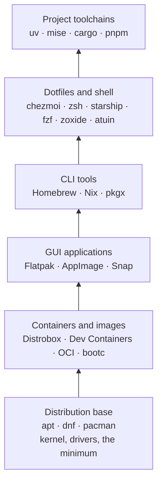

# The package manager map: one portable environment for WSL2 and VMs, from apt to OCI images

First entry in the Portable environments series. `apt` works on Ubuntu, `dnf` on Fedora, `pacman` on Arch, and each one stops at its distribution's border. Moving between them, or between a WSL2 distribution at work and a virtual machine at home, usually means rebuilding a setup by hand and forgetting half of it. This entry is the map for the rest of the series. It sorts the tools by the layer they manage, compares them, and states the rule that ties them together: the environment is described in one Git repository, and the machines are built from it.

The covered distributions are Ubuntu, Fedora and Arch. The targets are **WSL2** first, then **virtual machines** (VMs). WSL2 (*Windows Subsystem for Linux*, version 2) runs Linux distributions on Windows inside one shared, lightweight virtual machine; [the `.wslconfig` vs `wsl.conf` entry](../windows/wslconfig-vs-wsl-conf.md) explains how it is configured.

## What a package manager is

A **package** is an archive of files (programs, libraries, configuration) plus metadata: its name, its version, and the other packages it needs, called its *dependencies*. A **package manager** downloads packages from a *repository* (a server that publishes them), resolves their dependencies, installs them, and later upgrades or removes them.

"Package manager" is the right umbrella term, but it covers tools that work at very different layers. Mixing those layers is what produces most broken setups: `sudo pip install` overwriting files the distribution owns, three copies of Node.js, a system Python that no longer starts.

| Family | Manages | Examples | Scope |
|---|---|---|---|
| System package manager | The operating system: kernel, C library, drivers, services | `apt`, `dnf`, `pacman` | One distribution family, needs root |
| Universal package manager | User tools, independently of the distribution | Homebrew (`brew`), Nix, `pkgx` | Any distribution, macOS, WSL |
| Application format | Sandboxed desktop applications | Flatpak, Snap, AppImage | Any distribution (Snap is Ubuntu-first) |
| Language or runtime manager | Interpreters, compilers and libraries, per project | `uv`, `mise`, `cargo`, `pnpm` | Per user or per project |
| Dotfile manager | Your configuration files, across machines | chezmoi, GNU Stow, Home Manager | Per user |
| Configuration management | The desired state of whole machines | Ansible, tested with Molecule | One machine or many |
| Infrastructure as code | Creating and destroying machines | OpenTofu, cloud-init, `wsl --import` | VMs, WSL distributions |
| Container and image tools | A whole Linux userland as one file | Podman, Distrobox, bootc, [`wslc`](../windows/wslc-containers-in-wsl.md) | Anywhere a container runs; `wslc` on Windows, from WSL 2.9.3 (generally available since 3.0.1) |

Some of these terms need a sentence each:

- **Sandboxed**: the application runs with restricted access to the rest of the system, and asks for permissions (files, network, devices) instead of having them by default.
- **Dotfiles**: the configuration files in your home directory whose names start with a dot, such as `~/.zshrc` or `~/.gitconfig`.
- **Infrastructure as code** (IaC): machines described in text files that a tool applies, instead of being set up by hand. [The OpenTofu entry](../terraform/what-is-terraform-opentofu-and-how-it-works.md) explains the model; **cloud-init** is the program that configures a VM on its first boot from a *user data* file ([an example with OpenTofu](../cloud-init/vendor-data-alongside-terraform-user-data.md)).
- **Userland**: everything in a Linux system except the kernel: the shell, the libraries, the tools.
- **Container image** and **OCI**: an image is a packaged userland that a container engine such as Podman runs ([Docker and Podman hello world](../podman/docker-and-podman-hello-world.md)). OCI (*Open Container Initiative*) is the standard format these images follow, so the same image works with Podman, Docker and the other tools that read it.

## The layers

The way to stay independent of the distribution is to keep the distribution's own layer as small as possible and put everything you use on top of it, in tools that work the same everywhere:



Lower layers change rarely and higher layers change often. A distribution upgrade every year or two, a new CLI tool every month, a project dependency every day.

## Git is the source of truth, machines are disposable

This is the rule the whole series follows. It is the workstation version of GitOps, which [the DevOps terminology entry](../devops/devops-devsecops-dora-cicd-gitops-terminology.md#gitops) defines, and which [the GitOps with push tools entry](../gitops/gitops-with-push-tools-ansible-opentofu.md) compares against Ansible and OpenTofu.

1. Everything that defines the environment lives in one Git repository: package lists, lockfiles, dotfiles, playbooks, image recipes. A **lockfile** records the exact version of every dependency that was installed, so that a later install produces the same result.
2. A machine, WSL distribution or VM, is built from that repository and brought in line with it. Nothing important exists only on the machine.
3. To change something, change the repository, then apply it. A manual change on the machine is *drift*: a difference between the machine and its description, which the next apply overwrites.
4. To remove something, destroy the machine and rebuild it. With most system package managers, removing a package from a list doesn't uninstall it anywhere; a rebuild leaves nothing behind.
5. Secrets never go into the repository in plain text. They are encrypted, with `age` or `sops` for example, or fetched from a password manager when the machine is built.

A repository laid out this way could look like this:

```text
my-env/
├── bootstrap/   # PowerShell (wsl --import) and cloud-init user data
├── infra/       # OpenTofu for VMs
├── ansible/     # roles and Molecule tests
├── dotfiles/    # chezmoi source directory
├── packages/    # Brewfile, mise.toml, uv.lock, flake.nix
├── image/       # Containerfile: one OCI image for WSL, VMs and containers
└── Makefile     # make up, make check, make down
```

## The tools side by side

Two terms used in the table:

- **Declarative file**: a file that lists what should be installed, which the tool reads and applies. A `Brewfile` lists Homebrew packages; a `flake.nix` describes a Nix environment, and its `flake.lock` pins every input ([the standalone Home Manager entry](../nixos/home-manager-standalone-wsl-uv-ansible-opentofu.md) builds one on WSL2).
- **Version pinning**: fixing the exact version installed, so that installing again tomorrow gives the same result.

| Tool | Layer | Root needed | Declarative file | Version pinning | Ubuntu, Fedora, Arch | WSL2 |
|---|---|---|---|---|---|---|
| `apt`, `dnf`, `pacman` | Operating system | yes | none built in | only by repository snapshot | its own distribution only | yes |
| Homebrew | CLI tools | once, to install it | `Brewfile` | weak | all three | yes |
| Nix | anything | once, to install it | `flake.nix` | `flake.lock` | all three | yes |
| `pkgx` | CLI tools | no | per project | partial | all three | yes |
| Flatpak | desktop applications | no, with per-user installs | a scripted list | by commit | all three | through WSLg |
| Snap | applications and CLI tools | yes | a scripted list | by channel | Ubuntu-first | needs systemd |
| AppImage | desktop applications | no | none | the file is the version | all three | through WSLg |
| `uv` | Python | no | `pyproject.toml` | `uv.lock` | all three | yes |
| `mise` | runtimes and tools | no | `mise.toml` | `mise.lock` | all three | yes |
| chezmoi | dotfiles | no | its source repository | the Git commit | all three | yes |
| Ansible | whole machine | for system tasks | playbooks | you pin it | all three | yes |
| Distrobox | whole userland | no, with rootless Podman | `distrobox.ini` | the image tag | all three | yes |
| OCI image | whole userland or OS | no, to build it | `Containerfile` | the image digest | bootc: Fedora family only | through `wsl --import` |

**WSLg** is the part of WSL that displays Linux graphical applications on the Windows desktop. An AppImage is a single executable file; on recent distributions it often needs one extra library first ([the AppImage `libfuse2` error](../linux/appimage-libfuse2-error.md)). An **image digest** is the SHA-256 hash that identifies one exact image, where a tag such as `:latest` can point to a different image tomorrow. **bootc** builds a bootable operating system from an OCI image.

## Three strategies

Every tool above serves one of three ways of getting a machine into the described state:

| | Converge | Declare | Bake |
|---|---|---|---|
| Idea | Start from a stock machine and run tools that bring it to the described state, as many times as needed | Describe the whole environment with a lockfile and rebuild it exactly | Build one image in CI from a `Containerfile`, then run it as a container, a WSL distribution or a VM |
| Tools | cloud-init, Ansible, chezmoi, `Brewfile` | Nix flakes, Devbox, devenv | Podman, bootc, Packer |
| Strong at | quick changes, any distribution | reproducing an environment, rolling back | no drift, rolling back to the previous image |
| Weak at | removing things, drift | learning curve | a slower change loop: every change is a rebuild |

**CI** (*continuous integration*) here is a pipeline, such as GitHub Actions, that builds and tests on every push. [Packer](../packer/what-is-packer-and-how-it-works.md) builds VM images; the series uses it as one of the bake options.

## Where it has to run

The inner layers are the same on WSL2 and on a VM. Only the steps that create and destroy the machine differ:

| Step | WSL2 | VM |
|---|---|---|
| Create | `wsl --install`, or `wsl --import` from a root filesystem archive | OpenTofu or Vagrant, from the distribution's cloud image |
| First boot | cloud-init (best supported on Ubuntu) or a bootstrap script, and `/etc/wsl.conf` | cloud-init |
| Configure | Ansible, chezmoi, `Brewfile`, `mise`: the same on both | the same |
| Check for drift | `chezmoi diff`, `ansible-playbook --check --diff` | the same, plus `tofu plan` |
| Delete | `wsl --unregister`, after `wsl --export` if a backup is needed | `tofu destroy` |

## The series

1. The package manager map (this entry)
2. Distribution package managers side by side: `apt`, `dnf`, `pacman`
3. Cross-distribution CLI tools: Homebrew, Nix and `pkgx`
4. GUI applications: Flatpak, Snap, AppImage, and what works under WSLg
5. Toolchains: `uv`, `mise`, `pipx`, `cargo`
6. One command, any distribution: chezmoi, a bootstrap script and the zsh setup
7. Ansible and Molecule: the workstation as code, tested on Ubuntu, Fedora and Arch
8. Containers and immutable distributions: Distrobox, Toolbx, Dev Containers, Devbox, bootc
9. The full lifecycle as code on WSL2 and VMs, from `make up` to `make down`
10. Baking the environment: one OCI image for WSL, VMs and containers

This entry is an overview: no commands were run for it. The WSL commands it lists need Windows, and each later entry says where its own commands ran.
