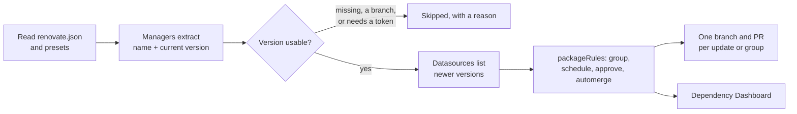

# Adding Renovate to a GitHub project: the hosted app, and the versions it can't see

[Renovate](https://docs.renovatebot.com/) is a bot that reads a repository, finds every dependency whose version is written down, looks up newer releases and opens one pull request per update. It's open source, and [Mend](https://www.mend.io/) maintains it and runs a free hosted version. Getting it onto a project takes two steps: choose who runs it, and then make sure every version you care about is written somewhere Renovate can read. This entry runs it on GitHub. Most of it, from the configuration on, applies wherever Renovate runs.

The terms this relies on:

- **Pull request** (PR): a proposed change on its own branch, reviewed and merged on GitHub. Renovate opens one for each update. GitLab calls the same thing a merge request.
- **Manager**: the Renovate module that understands one kind of file, such as `ansible-galaxy` for `requirements.yml`, `dockerfile` for a Dockerfile, `terraform` for `.tf` files or `github-actions` for workflows. It *extracts* each dependency's name and current version.
- **Datasource**: where Renovate looks up the available versions of a dependency, such as Ansible Galaxy, a container registry, the Terraform registry, a Helm chart repository, the GitHub releases API or plain `git ls-remote`.
- **Preset**: a named, reusable piece of Renovate configuration, pulled in with `"extends"`. `config:recommended` is the usual starting point.
- **Onboarding PR**: the first PR Renovate opens on a repository, titled "Configure Renovate". It adds a `renovate.json` and lists what Renovate found. Nothing else happens until you merge it.
- **Dependency Dashboard**: an issue Renovate keeps up to date with every pending, open and ignored update, with checkboxes to trigger or approve them.
- **Lock file**: a file that records the exact version of every dependency, next to the file that holds the version constraints. [Pinning ansible-core](../ansible/pinning-ansible-core-pip-tools-uv-poetry.md) explains the difference.
- **Digest**: the hash that identifies one exact commit or image, as opposed to a tag such as `v4` that can move.

One Renovate run, wherever it runs:



## Who runs it

On GitHub.com there are two ways:

- **Hosted by Mend, free**: the **Mend Renovate app** from [github.com/apps/renovate](https://github.com/apps/renovate), installed on a user or an organization, for all or selected repositories.
- **Self-hosted**: the [`renovatebot/github-action`](https://github.com/renovatebot/github-action) Action (v46.3.12), run with a token or your own GitHub App.

The Renovate documentation advises the hosted app for most users. Mend then keeps the token, schedules runs and updates the Renovate version. On the free Community Cloud plan, Mend runs one job per organization at a time, schedules each active repository every 4 hours, and stops a job after 30 minutes. It also reacts to webhooks, so ticking a box on the dashboard starts a job without waiting for the schedule.

## GitHub: install the Mend Renovate app

1. Open [github.com/apps/renovate](https://github.com/apps/renovate), select **Install**, and pick the account.
2. Choose **All repositories** or **Only select repositories**. With "All repositories", Renovate skips forks and repositories without any file it recognises. With "Select repositories", it processes forks too.
3. Wait for the "Configure Renovate" PR on each repository. Renovate opens it from a branch named `renovate/configure`. Push changes to `renovate.json` on that branch, and Renovate rewrites the PR description to show what the new configuration would do.
4. Merge it. Closing it without merging opts the repository out.

A repository that already has a `renovate.json` on its default branch skips the onboarding PR: Renovate treats it as onboarded, and its first run opens the Dependency Dashboard issue instead.

The app asks for read access to administration (to read branch protection), Dependabot alerts and metadata. It asks for read and write access to code, checks, commit statuses, issues, pull requests and **workflows**: GitHub requires that last permission separately before an app can change a file under `.github/workflows/`. Mend's web portal, [developer.mend.io](https://developer.mend.io/), shows each job's log and can start a run on demand.

### When nothing appears on GitHub: Silent mode

Renovate can run on a repository and still leave no trace on GitHub: no onboarding PR, no Dependency Dashboard issue, no `renovate/*` branch. The usual reason is the app's **Silent** mode. Mend's documentation says Silent runs Renovate as a dry run that only looks up versions (`dryRun=lookup`), and that "it's not just no PRs, it's also no Issues". Mend's documentation describes it as the default when an account installs the app on **All repositories**, so that one click doesn't onboard hundreds of repositories at once. Don't rely on that alone: in the install recorded at the end of this entry, the app was installed on **Selected repositories** and both repositories still came up Silent.

To see which mode a repository is in, sign in to [developer.mend.io](https://developer.mend.io/) with GitHub and open the repository. The page shows:

- **Dependency Updates (Renovate):** the mode, Silent or Interactive;
- **Recent jobs:** each run, with its log;
- **Renovate Updates:** the updates the last run found;
- **Detected Dependencies:** every dependency, grouped by manager and file. It's a quick way to check that a `# renovate:` comment or a regex manager matches.

So in Silent mode the portal can list updates while GitHub stays empty. To get the onboarding PR or the dashboard, switch the mode to **Interactive**, for one repository from its **Settings** button, or for the whole account at the account level. The change applies from the next job, which the portal can start on demand.

To run Renovate yourself instead, the Action runs the Renovate container image with a token. The documentation lists the permissions a fine-grained token needs: read and write on contents, issues, pull requests, commit statuses and workflows, plus read on Dependabot alerts and organization members. A classic token needs the `repo` scope, and `workflow` to update Actions. Give the self-hosted bot a `branchPrefix` other than the default `renovate/`, so that it doesn't fight with the app if both ever run on one repository.

## The configuration

The onboarding PR proposes a `renovate.json` like this one:

```json
{
  "$schema": "https://docs.renovatebot.com/renovate-schema.json",
  "extends": ["config:recommended"]
}
```

`config:recommended` turns on the Dependency Dashboard and groups packages released together, such as the parts of a monorepo. It applies Renovate's package replacements and workarounds, and adds changelog links and release-age badges to the PRs. When the history already uses [Conventional Commits](../git/conventional-commits-messages-that-tools-can-read.md), the onboarding PR turns on semantic commit messages, so Renovate's commits follow the same `type(scope): summary` form. The file can also live at `.github/renovate.json` or `.renovaterc.json`, among others.

Check the file before you push it. Renovate 44.222.2 needs Node.js 24.11 or later (or 26.13 or later):

```console
$ npx --yes --package renovate@44.222.2 -- renovate-config-validator --strict
 INFO: Validating renovate.json
 INFO: Config validated successfully against 1 file(s)
```

`--strict` also fails when the file uses an option that Renovate has since renamed.

## What Renovate finds, and what it can't see

To see what Renovate would do before installing anything, run it against a clone with the `local` platform. The platform is experimental. It only looks versions up (`dryRun=lookup`) and never creates branches. `--report-type=file` writes every dependency and proposed update to a JSON file:

```sh
cd my-project
npx --yes --package renovate@44.222.2 -- renovate --platform=local \
  --report-type=file --report-path=/tmp/renovate-report.json
```

The test project mixed the files of an RKE2 lab repository: an Ansible `requirements.yml`, a Dockerfile, a `.gitlab-ci.yml`, a GitHub workflow, an [OpenTofu provider](../terraform/what-is-terraform-opentofu-and-how-it-works.md), RKE2 and Longhorn versions in an Ansible vars file, and a flake. Before any change, the report said:

| File | Dependency as written | Result |
|---|---|---|
| `requirements.yml` | role `lablabs.rke2`, `version: main` | skipped: `invalid-value` |
| `requirements.yml` | collection `kubernetes.core`, no version | skipped: `unspecified-version` |
| `requirements.yml` | collection `community.general` `11.0.0` | 11.4.10 (minor), 14.0.0 (major), as two PRs |
| `Dockerfile` and `.gitlab-ci.yml` | `docker.io/library/python:3.12-slim` | `3.15-slim` |
| `main.tf` | provider `bpg/proxmox`, `~> 0.66` | `~> 0.120`, in one jump |
| workflow | `actions/checkout@v4` | skipped: `github-token-required` |
| `Dockerfile` | `RUN curl … get-helm-3 \| bash`, from `main` | not seen at all |

What each of those needs:

**A branch name isn't a version.** `version: main` and a missing version leave Renovate nothing to compare with. Pinned to the role's tag `1.53.0`, `lablabs.rke2` was looked up with the `git-tags` datasource and got a PR to `1.54.0`. Pinned to `5.0.0`, `kubernetes.core` got PRs to 5.5.0 and 6.6.0.

**A version in a variable needs a `# renovate:` comment.** No manager knows that `ARG KUBECTL_VERSION=v1.31.0` in a Dockerfile is kubectl. The `customManagers:dockerfileVersions` preset reads a comment on the line above any `ARG` or `ENV` whose name ends in `_VERSION`:

```dockerfile
# renovate: datasource=docker depName=registry.k8s.io/kubectl
ARG KUBECTL_VERSION=v1.31.0
```

The comment has to name a datasource that actually publishes the versions. The first try, `docker.io/bitnami/kubectl`, came back with "Found no results from datasource that look like a version". `registry.k8s.io/kubectl` returned the full list.

Files that no preset covers need a regex manager of your own. For Ansible vars files with the same comment convention:

```yaml
# renovate: datasource=helm depName=longhorn registryUrl=https://charts.longhorn.io
longhorn_version: "1.7.2"
```

```json
"customManagers": [
  {
    "customType": "regex",
    "description": "Versions in Ansible vars files, marked with a renovate comment",
    "managerFilePatterns": ["/^ansible/.+\\.ya?ml$/"],
    "matchStrings": [
      "# renovate: datasource=(?<datasource>\\S+) depName=(?<depName>\\S+)( registryUrl=(?<registryUrl>\\S+))?\\n\\w+_version: \"?(?<currentValue>[^\"\\n]+)\"?"
    ]
  }
]
```

That found `longhorn` and offered 1.13.0. RKE2 works the same way, with one trap. Its versions are tags in `rancher/rke2`, and the first attempt read them with the `git-tags` datasource, which uses `git ls-remote` and needs no GitHub token. It skipped the release candidates and offered `v1.37.2+rke2r1`, but the per-minor branches it proposed (next section) included `v1.31.14+rke2r2`, `v1.32.13+rke2r2` and `v1.33.13+rke2r3`. Those exist as tags and were never released: there are no release files behind them. Upgrading a cluster to `v1.30.14+rke2r4`, another such tag, stopped in the RKE2 install script:

```text
[INFO]  downloading checksums at https://github.com/rancher/rke2/releases/download/v1.30.14%2Brke2r4/sha256sum-amd64.txt
curl: (22) The requested URL returned error: 404
```

Read RKE2 from its published GitHub releases instead. The `github-releases` datasource leaves out drafts and tags without a release, and treats pre-releases as unstable, which Renovate doesn't propose by default:

```yaml
# renovate: datasource=github-releases depName=rancher/rke2
rke2_version: "v1.31.4+rke2r1"
```

That lookup goes through the GitHub API, so it needs a token (see below). To check by hand whether a version has release files:

```sh
v=v1.30.14+rke2r2
curl -sfIL -o /dev/null "https://github.com/rancher/rke2/releases/download/${v/+/%2B}/sha256sum-amd64.txt" && echo released
```

For 1.30 to 1.33, the newest released versions were one `rke2rN` behind the newest tags: `v1.30.14+rke2r2`, `v1.31.14+rke2r1`, `v1.32.13+rke2r1` and `v1.33.13+rke2r2`.

**An install script fetched from `main` can't be tracked.** Renovate only reads versions written in files. Download a release by version instead (Helm publishes one tarball per version on `get.helm.sh`), put the version in an `ARG` with a comment, and the line becomes an update like any other.

**The GitHub API needs a token.** The run warned `GitHub token is required for some dependencies` for `actions/checkout` and `opentofu/opentofu`, because the container it ran in couldn't reach the GitHub API. The `github-tags` and `github-releases` datasources go through that API. `git-tags` doesn't, which makes it tempting, but it lists every tag, released or not: the RKE2 trap above. The Mend app on GitHub has a token already. A self-hosted Renovate on another platform needs a GitHub token of its own for these lookups.

For workflows on GitHub, `helpers:pinGitHubActionDigests` pins each action to a commit digest, and Renovate then updates the digest according to the tag in a version comment (`uses: actions/checkout@<sha> # v4`). An action pinned to a bare digest, with no version comment, isn't updated at all, because Renovate can't tell which tag it belongs to. Those lookups need the GitHub API, so the run here doesn't show them.

## Kubernetes minors, one at a time

By default, Renovate offers only the newest minor: kubectl at `v1.31.0` got one PR straight to `v1.37.2`, and RKE2 one to `v1.37.2+rke2r1`. That's six minors at once. [RKE2](../kubernetes/what-is-rke2-and-how-it-works.md) runs the Kubernetes API server, which the Kubernetes version skew policy says must not skip a minor version when it's upgraded. kubectl is only supported within one minor of that API server, so the two should also move together.

`separateMultipleMinor` gives each minor its own branch. `groupName` puts RKE2 and kubectl in the same branch. With both, the run produced one branch per minor, each carrying both updates: `renovate/minor-1.32-kubernetes` held RKE2 1.32 and kubectl `v1.32.13`, and so on up to 1.37. The patch updates within 1.31 went to `renovate/kubernetes`.

Without anything else, all seven PRs would be created as Renovate's rate limits allow, which is 2 an hour and 10 open at a time by default. `dependencyDashboardApproval` holds each one back until its checkbox is ticked on the Dependency Dashboard, so the cluster moves one minor per approval:

```json
"packageRules": [
  {
    "description": "Cluster components: one PR per minor, created only when approved on the dashboard",
    "matchDepNames": ["registry.k8s.io/kubectl", "rancher/rke2", "longhorn"],
    "separateMultipleMinor": true,
    "dependencyDashboardApproval": true
  },
  {
    "description": "RKE2 and kubectl move together",
    "matchDepNames": ["registry.k8s.io/kubectl", "rancher/rke2"],
    "groupName": "kubernetes"
  }
]
```

Longhorn got the same treatment on its own: 1.7.3, then one branch for each of 1.8 to 1.13.

Merging one of these PRs only changes the pin: the cluster changes when the playbook runs. [The RKE2 upgrade entry](../kubernetes/rke2-upgrade-with-the-lablabs-rke2-role.md) follows what that run does on each node.

## Nix flakes: opt in, and the channel moves too

The `nix` manager reads `flake.nix` and its lock (a flake is a Nix project whose inputs are pinned in `flake.lock`: see the flakes section of [NixOS first steps](../nixos/first-steps-configuration-generations-rollback.md)). It is in beta and off by default:

```json
"nix": { "enabled": true }
```

With it on, an input that follows a NixOS release branch is treated as a version. The `nixpkgs` versioning knows the release names:

```text
nix  flake.nix  nixpkgs  cur=nixos-25.11  ->  nixos-26.05 (major)
```

So Renovate does propose the twice-yearly channel switch in `flake.nix`, as a major update. To rewrite `flake.lock` it runs `nix flake update nixpkgs`, so the job needs the `nix` command. It only changes the flake's own input, though. The same release name, such as `nixos-26.05`, in a CI image tag, a workflow's `nix_path` or a test file is plain text to Renovate. Either keep it in one place, or mark each copy with a `# renovate:` comment and a regex manager. With `"lockFileMaintenance": { "enabled": true }`, Renovate also opens a PR that refreshes every lock file it supports, `flake.lock` included, on its own schedule, `before 4am on monday` by default.

## A starting configuration

This is the file the last run used, except that RKE2 is now matched as `rancher/rke2`, its `github-releases` name. It validates with `--strict` on 44.222.2:

```json
{
  "$schema": "https://docs.renovatebot.com/renovate-schema.json",
  "extends": [
    "config:recommended",
    "customManagers:dockerfileVersions",
    "helpers:pinGitHubActionDigests"
  ],
  "timezone": "Europe/Brussels",
  "schedule": ["before 6am on monday"],
  "lockFileMaintenance": { "enabled": true },
  "nix": { "enabled": true },
  "customManagers": [
    {
      "customType": "regex",
      "description": "Versions in Ansible vars files, marked with a renovate comment",
      "managerFilePatterns": ["/^ansible/.+\\.ya?ml$/"],
      "matchStrings": [
        "# renovate: datasource=(?<datasource>\\S+) depName=(?<depName>\\S+)( registryUrl=(?<registryUrl>\\S+))?\\n\\w+_version: \"?(?<currentValue>[^\"\\n]+)\"?"
      ]
    }
  ],
  "packageRules": [
    {
      "description": "Cluster components: one PR per minor, created only when approved on the dashboard",
      "matchDepNames": ["registry.k8s.io/kubectl", "rancher/rke2", "longhorn"],
      "separateMultipleMinor": true,
      "dependencyDashboardApproval": true
    },
    {
      "description": "RKE2 and kubectl move together",
      "matchDepNames": ["registry.k8s.io/kubectl", "rancher/rke2"],
      "groupName": "kubernetes"
    },
    {
      "description": "GitHub Actions: automerge digests, patches and minors once CI is green",
      "matchManagers": ["github-actions"],
      "matchUpdateTypes": ["digest", "pinDigest", "patch", "minor"],
      "automerge": true
    }
  ]
}
```

`schedule` limits when Renovate creates or updates branches. `timezone` makes it read that schedule in local time instead of UTC. `automerge` merges a PR once its status checks pass.

Renovate 44.222.2 (the npm `latest` tag on 2026-11-08) ran on Node.js 24.22.2 in a Linux cloud container, with the `local` platform against a scratch Git repository. The registries answered: Ansible Galaxy, Docker Hub, `registry.k8s.io`, the Terraform registry, `charts.longhorn.io`, and `git ls-remote` against GitHub. The GitHub API didn't answer, so no GitHub-hosted version was looked up. The local platform creates no branches, so the Dependency Dashboard, the approval checkboxes and automerge weren't exercised. The Action wasn't installed: those steps come from the documentation listed below. The Mend app was installed on 2026-11-08 by the repository owner, with **Only select repositories**, on two private repositories that already had a `renovate.json` on `main`. Both showed **Silent** on developer.mend.io after the install: their jobs completed and the portal listed the detected dependencies and updates, but nothing appeared on GitHub until the mode was switched to Interactive. The next job, a few minutes later, opened the Dependency Dashboard issue in each repository, with no onboarding PR, since both already had a config on `main`. In that portal, the app also found an update the local run couldn't look up without the GitHub API (`cachix/install-nix-action` v31.11.1 to v31.11.3). The first upgrade the owner ran from those PRs hit the unreleased RKE2 tag described above; the `curl` check against the release files ran in the container, but the `github-releases` lookup itself couldn't, without the GitHub API.

## Sources

- Renovate documentation, for 44.222.2: [Installing and onboarding](https://docs.renovatebot.com/getting-started/installing-onboarding/), [Mend-hosted apps](https://docs.renovatebot.com/mend-hosted/overview/), [Mend-hosted apps configuration](https://docs.renovatebot.com/mend-hosted/hosted-apps-config/) (Silent mode, onboarding), [Security and permissions](https://docs.renovatebot.com/security-and-permissions/), [GitHub platform](https://docs.renovatebot.com/modules/platform/github/), [Local platform](https://docs.renovatebot.com/modules/platform/local/), [Config validation](https://docs.renovatebot.com/config-validation/), [Nix manager](https://docs.renovatebot.com/modules/manager/nix/), [Regex manager](https://docs.renovatebot.com/modules/manager/regex/), [GitHub Releases datasource](https://docs.renovatebot.com/modules/datasource/github-releases/), [GitHub Actions manager](https://docs.renovatebot.com/modules/manager/github-actions/), [Scheduling](https://docs.renovatebot.com/key-concepts/scheduling/) and [Configuration options](https://docs.renovatebot.com/configuration-options/) (`separateMultipleMinor`, `dependencyDashboardApproval`, `groupName`, `lockFileMaintenance`, `timezone`).
- Preset definitions read from the installed `renovate@44.222.2` package (`dist/config/presets/internal/`), the nix manager's default config and `flake.lock` update command (`dist/modules/manager/nix/`), and how `github-releases` drops drafts and marks pre-releases unstable (`dist/util/github/graphql/query-adapters/releases-query-adapter.js`).
- [renovatebot/github-action](https://github.com/renovatebot/github-action): README, latest tag v46.3.12.
- Kubernetes: [Version skew policy](https://kubernetes.io/releases/version-skew-policy/) (`kube-apiserver` minor upgrades, kubectl).
