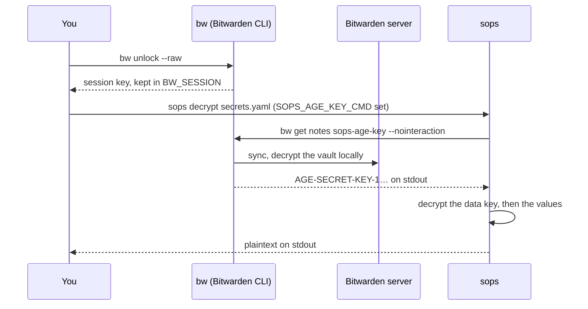

# Keep the SOPS age key in Bitwarden: `SOPS_AGE_KEY_CMD` runs `bw` and the key never touches the disk

SOPS encrypts secrets inside files that are then safe to commit, and by default it reads its private key from a plain file in your home directory. That file is the one thing worth stealing. Since SOPS 3.10.0 it can run a command instead and read the key from its output, so the key can live in a Bitwarden vault and come out only while the vault is unlocked.

The terms first:

- **[SOPS](https://getsops.io/)** (Secrets OPerationS) encrypts the *values* of a YAML, JSON, ENV or INI file and leaves the keys readable, so a diff still shows which secret changed. Each file is encrypted with a random data key, and that data key is encrypted to one or more *recipients*.
- **[age](https://github.com/FiloSottile/age)** is a small file-encryption tool. Its key pair is a private *identity* (`AGE-SECRET-KEY-1…`) and a public *recipient* (`age1…`). SOPS can use age recipients, and only needs the public one to encrypt.
- **Bitwarden** is a password manager. **`bw`** is its official command-line client, and **Vaultwarden** a compatible server that the same client talks to.
- A **secure note** is a Bitwarden vault item made of free text, with no username or password field. It fits an age identity, which is a few lines of text.



Versions used: Bitwarden CLI 2026.10.1 (npm `@bitwarden/cli`), SOPS 3.13.3, age 1.1.1, against Vaultwarden 1.37.5 on localhost.

## Where SOPS looks for an age key

From [the SOPS age documentation](https://getsops.io/docs/usage/identities/age/), on Linux SOPS reads `$XDG_CONFIG_HOME/sops/age/keys.txt`, or `$HOME/.config/sops/age/keys.txt` when `XDG_CONFIG_HOME` isn't set. Three environment variables override that:

| Variable | Holds |
|---|---|
| `SOPS_AGE_KEY_FILE` | the path of a key file |
| `SOPS_AGE_KEY` | the key itself |
| `SOPS_AGE_KEY_CMD` | a command whose standard output is the key |

`SOPS_AGE_KEY_CMD` was added in [SOPS 3.10.0](https://github.com/getsops/sops/blob/main/CHANGELOG.md). Since 3.12.0 SOPS also sets `SOPS_AGE_RECIPIENT` for the command, so one command can pick the key that matches the file's recipient.

The command isn't run through a shell. In [`age/keysource.go`](https://github.com/getsops/sops/blob/v3.13.3/age/keysource.go) SOPS splits the string into words the way a shell would quote them (`shlex.Split`) and runs the first word directly. A pipe, a redirection or `$VAR` in the string is passed to the program as a literal argument. For any of those, wrap it: `SOPS_AGE_KEY_CMD="sh -c '…'"`. The command inherits SOPS's environment, which is how `bw` gets `BW_SESSION`.

## Put the key in the vault

Log in once, then unlock. `bw unlock --raw` prints only the session key, which every later `bw` command reads from `BW_SESSION` ([Bitwarden CLI docs, "Using a session key"](https://bitwarden.com/help/cli/#using-a-session-key)):

```bash
bw config server https://vault.example.com   # skip for bitwarden.com
bw login you@example.com
export BW_SESSION="$(bw unlock --raw)"
```

Generate the key pair, store the identity as a secure note named `sops-age-key`, and delete the file. A secure note is `type` 2 and needs a `secureNote` sub-object; `bw create item` takes the item as base64-encoded JSON, which `bw encode` produces ([Bitwarden CLI docs, "create"](https://bitwarden.com/help/cli/#create)):

```bash
age-keygen -o key.txt
bw get template item \
  | jq --rawfile k key.txt '.type=2 | .secureNote={type:0} | .name="sops-age-key" | .notes=$k | .login=null' \
  | bw encode | bw create item | jq -r '.name, .type' \
  && shred -u key.txt
```

```text
Public key: age1jux53v2f2mwrmptvnp4wc0jfftk5w4e5jwy774nmwqmdjqydqyssurkx2m
sops-age-key
2
```

The `&&` matters: if `bw create item` fails, the key file stays and you haven't lost the only copy. The public key goes into the repository's `.sops.yaml`, which tells SOPS which recipients to encrypt new files to:

```yaml
creation_rules:
  - age: age1jux53v2f2mwrmptvnp4wc0jfftk5w4e5jwy774nmwqmdjqydqyssurkx2m
```

Encrypting needs only that public key, so `sops encrypt -i secrets.yaml` works with no vault at all:

```text
db_password: ENC[AES256_GCM,data:jcQOon6Jfg==,iv:LXWK…,tag:q4/N…,type:str]
```

## Decrypt through `bw`

```bash
export SOPS_AGE_KEY_CMD='bw get notes sops-age-key --nointeraction'
sops decrypt secrets.yaml
```

```text
db_password: hunter2
```

`sops edit` and `sops exec-env` work the same way, since they load the key through the same code. `sops exec-env secrets.yaml 'printenv db_password'` prints `hunter2`: the secret goes into a child process's environment and never into a file.

`bw get notes` takes an item ID or a search term, and the search matches parts of names. Add a second note called `sops-age-key-old` and the command fails with status 1, listing both IDs:

```text
More than one result was found. Try getting a specific object by `id` instead. The following objects were found:
16344668-c695-40c7-bad8-55852430f76f
70efe78a-5a0d-4dc1-9113-7974755a2452
```

Put the ID in `SOPS_AGE_KEY_CMD` (`bw get item sops-age-key | jq -r .id`, while the name is still unique) and renaming or adding notes can't break it.

## Keep `--nointeraction`

With the vault locked, `bw` normally asks for the master password. SOPS runs the command with no terminal on its standard input, so the prompt reads nothing, and `bw` exits with status **0** and prints nothing on standard output:

```text
$ bw lock
$ bw get notes sops-age-key </dev/null; echo "rc=$?"
? Master password: [input is hidden]
rc=0
```

SOPS then gets an empty key list from a command that succeeded, and its error doesn't mention the command at all:

```text
failed to load age identities. Did not find keys in
locations 'SOPS_AGE_SSH_PRIVATE_KEY_FILE',
'SOPS_AGE_SSH_PRIVATE_KEY_CMD', '/root/.ssh/id_ed25519',
'/root/.ssh/id_rsa', 'SOPS_AGE_KEY', 'SOPS_AGE_KEY_FILE',
and 'SOPS_AGE_KEY_CMD'.
```

`--nointeraction` is the global option "Do not prompt for interactive user input" ([Bitwarden CLI docs, global options](https://bitwarden.com/help/cli/)). With it, a locked vault makes `bw` print `Vault is locked.` on standard error and exit with status 1, and SOPS names the culprit:

```text
failed to load age identities. Errors while loading age
identities: failed to execute command bw get notes
sops-age-key --nointeraction: exit status 1.
```

A stale `BW_SESSION`, for example after `bw lock` or another `bw unlock` (each unlock invalidates the previous session key), fails the same way.

## What it protects, and what it doesn't

- **On disk**: nothing. The identity exists in the vault, encrypted, and in the memory of `bw` and `sops` while they run.
- **While unlocked**: anything that can read `BW_SESSION` from your shell can read the whole vault, not only this note. `bw lock` ends that; keep the variable in the one shell that needs it.
- **Automation**: a CI job can do the same with `bw login --apikey` (from `BW_CLIENTID` and `BW_CLIENTSECRET`) and `bw unlock --passwordenv BW_PASSWORD`, which reads the master password from that variable. That puts the master password in CI's secret store, for a vault that holds more than this key.

## Sources

- SOPS: [age identities](https://getsops.io/docs/usage/identities/age/), [CHANGELOG](https://github.com/getsops/sops/blob/main/CHANGELOG.md) (3.10.0 and 3.12.0 entries), and [`age/keysource.go` in v3.13.3](https://github.com/getsops/sops/blob/v3.13.3/age/keysource.go).
- Bitwarden: [Password Manager CLI](https://bitwarden.com/help/cli/).
- [How to use Bitwarden CLI](https://computingforgeeks.com/how-to-use-bitwarden-cli/) on ComputingForGeeks, a tour of `bw` that has nothing on SOPS.

The commands ran in a Linux cloud container against a throwaway Vaultwarden 1.37.5 on localhost with a self-signed certificate (`NODE_EXTRA_CA_CERTS` pointed `bw` at it), not against bitwarden.com.
