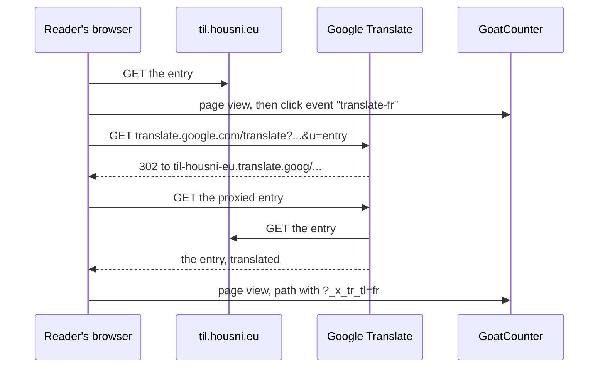

# A "read in French" link on a static site: Google's translation proxy, the reader's language, and what it does to SEO and accessibility

Every entry on this site is in English, and I wanted French-speaking readers to get a French page in one click, without writing or maintaining translations. The result is the pair of rounded buttons under the homepage's title and each entry's header: "Lire en français · traduction automatique Google" and "Traduire sur votre ordinateur · Firefox". It's two links in the page template, about 30 lines of JavaScript, and an attribute that the site's statistics tool already understands. Most of the work was finding out what such a link can and can't do.

## The only link that translates a whole page

A link can only do this through a translation *proxy*: a service that fetches the page itself, translates it and serves the result from its own address. Google Translate has one, and its old entry point still works:

```text
https://translate.google.com/translate?sl=en&tl=fr&hl=fr&u=https://til.housni.eu/linux/change-the-logrotate-timer-schedule.html
```

`sl` is the source language, `tl` the target language, `hl` the language of Google's own interface around the page, and `u` the page. It answers with a `302`, an HTTP redirect, to the proxy proper, whose host name is the site's with its dots turned into hyphens:

```text
https://til-housni-eu.translate.goog/linux/change-the-logrotate-timer-schedule.html?_x_tr_sl=en&_x_tr_tl=fr&_x_tr_hl=fr
```



Linking to `translate.google.com` saves building that host name yourself. In Chromium, through the proxy, the headings and text came back in French, while fenced code blocks and inline code were left untouched, and the [Mermaid diagrams](../github-pages/mermaid-diagrams-in-markdown.md) still rendered. That matters most on a site made of commands. The one glitch: Google sometimes drops the space after inline code ("`ansible-vault`et"). The proxy also rewrites the page's links to stay on `translate.goog`: from the translated homepage, a click on an entry opened that entry in French too, so one link on the homepage is enough to browse the whole site translated.

I looked for a European service that does the same, and found none that works from a link:

- **DeepL** translates whole pages only through its browser extension, and only for Pro subscribers ([DeepL support](https://support.deepl.com/hc/en-us/articles/4407580229522)).
- **eTranslation**, the European Commission's service, needs an account and is open to public administrations, universities and small businesses, not to the public ([european-alternatives.eu](https://european-alternatives.eu/alternative-to/google-translate)).
- **Bing**'s page translator, `translatetheweb.com`, answered with an expired TLS certificate on 2026-11-02.
- Google's own embeddable widget (`translate_a/element.js`) has been closed to new sites since 2019, and it would load Google's script for every visitor instead of only for those who click.

## What the link does to search engines

Copying a whole site under another address looks like *duplicate content*, the same text at two URLs, which search engines have to pick between. The proxy avoids that. Its response carries two signals:

```text
x-robots-tag: none
<meta name="robots" content="none">
<link rel="canonical" href="https://til.housni.eu/linux/change-the-logrotate-timer-schedule.html">
```

`none` is shorthand for `noindex, nofollow`: don't index this page, don't follow its links. The *canonical* link names the original URL as the one to rank. The translated page is never indexed, and the English one keeps everything.

Two things follow:

- The link carries `rel="nofollow"`, which tells search engines not to count it as an endorsement of Google Translate.
- The page gets no `<link rel="alternate" hreflang="fr">` in its `<head>`. That tag announces a translation of the page *on the same site*, which search engines then index and show to French searchers. Google also ignores the tag unless the other page links back with its own `hreflang`, which a proxied page that says `noindex` never does.

The flip side: the link does nothing for French search results. Only French pages hosted on the site itself would.

## What the label needs for accessibility

The [WCAG 2.2](https://www.w3.org/TR/WCAG22/) success criteria, the reference for web accessibility, decide most of the markup:

- **`lang="fr"` on the link** (3.1.2, Language of Parts). A screen reader picks its voice from `lang`. Without it, "Lire en français" is read with English pronunciation, which makes it hard to understand.
- **A label that says where the link goes** (2.4.4, Link Purpose): a machine translation, by Google, so the reader knows they're leaving the site.
- **No flag.** A flag is a country, not a language: French is spoken in Belgium, France, Switzerland and Quebec, among others.
- **The same tab**, so the Back button returns to the English page, and **the same place on every entry** (3.2.3, Consistent Navigation).
- **Icons hidden from screen readers.** The globe and the padlock are inline SVG with `aria-hidden="true"`, so they add nothing to what's read out; the padlock only hints that Firefox keeps the text on the computer.
- **A target big enough for a finger**: each button is 36 pixels high, above the 24 pixels of 2.5.8 (Target Size, Minimum).

```html
<a id="translate-google" class="chip"
   href="https://translate.google.com/translate?sl=en&amp;tl=fr&amp;hl=fr&amp;u=https://til.housni.eu/linux/change-the-logrotate-timer-schedule.html"
   lang="fr" hreflang="fr" rel="nofollow"
   data-goatcounter-click="translate-fr"
   data-goatcounter-title="Lire en français (traduction automatique Google)"><svg aria-hidden="true" focusable="false" ...>...</svg><span class="label">Lire en français</span> <small>traduction automatique Google</small></a>
```

The middle dot between the label and the `<small>` text comes from CSS, with an empty alternative text so that screen readers don't read it out: `content: "\00B7 " / "";`. The link's accessible name is then "Lire en français traduction automatique Google".

On a link, `hreflang` only hints at the language of the page it points to; unlike the `<head>` tag above, it's harmless.

## Following the reader's browser language

A browser lists its user's preferred languages in `navigator.languages`, most preferred first. Showing the link only to readers whose browser is set to French would miss the people it's for: many French-speaking sysadmins run their browser in English, and a browser set to French already offers to translate an English page. So the French link is the default for everyone, also without JavaScript. A script then retargets the link only when the first browser language is neither English nor French:

```js
(function () {
  var tag = (navigator.languages && navigator.languages[0]) || navigator.language || "";
  var lang = tag.split("-")[0].toLowerCase();
  if (!lang || lang === "en" || lang === "fr") return;
  // Google Translate needs the script variant for Chinese.
  if (lang === "zh") lang = /-(tw|hk|mo|hant)\b/i.test(tag) ? "zh-TW" : "zh-CN";
  var name;
  try {
    name = new Intl.DisplayNames([lang], { type: "language" }).of(lang);
  } catch (e) {
    return;
  }
  if (!name || name === lang) return;
  var google = document.getElementById("translate-google");
  var url = new URL(google.href);
  url.searchParams.set("tl", lang);
  url.searchParams.set("hl", lang);
  google.href = url.href;
  google.lang = google.hreflang = lang;
  name = name.charAt(0).toLocaleUpperCase(lang) + name.slice(1);
  google.dataset.goatcounterClick = "translate-" + lang;
  google.dataset.goatcounterTitle = name + " (Google Translate)";
  var label = google.querySelector(".label");
  label.textContent = name;
  label.dir = "auto";
  google.querySelector("small").textContent = "Google Translate";
})();
```

`Intl.DisplayNames`, built into browsers, gives a language's name in any language. Asked for Spanish *in Spanish*, it returns "español"; for Arabic, "العربية". The label is therefore always in the reader's own language, and nobody has to translate it by hand. The script changes only the label's text, so the icon stays. `dir="auto"` on the name alone lets the browser lay out a right-to-left name such as Arabic correctly; set on the whole link, it turned the whole button round. The same script switches the Firefox button to English, since its French label means nothing to a Spanish reader.

In Chromium with eight browser locales, `fr-BE` and `en-US` kept the French link. `es-ES` gave "Español · Google Translate", and `ar-MA`, `de-CH` and `nl-BE` their own languages. `zh-TW` and `zh-CN` were kept apart, which Google's `tl` needs. `es-ES` with JavaScript turned off showed the French link.

## The browser's own translation can't be triggered from a page

The first idea was a link that opens the browser's built-in translation. There is no way to do it:

- Chrome's translate bar and Firefox's translation panel belong to the browser, and no web API opens them.
- Firefox's `about:translations` page and Chrome's `chrome://` pages can't be linked from a web page: browsers block it.
- The browser decides alone when to offer a translation, by comparing the page's `lang` with its user's languages.

What a page can do is point at a browser feature, as the second link does. Firefox's translation, from the Bergamot project led by the University of Edinburgh, runs on the reader's own computer, so the text never leaves it ([Mozilla](https://support.mozilla.org/kb/website-translation)). Mozilla's page contrasts this with Chrome and Edge, whose built-in translation sends the text to Google's and Microsoft's servers. Through Chrome, then, clicking the Google link changes little.

The closest thing to "the browser translates" is Chrome's [Translator API](https://developer.chrome.com/docs/ai/translator-api), stable since Chrome 138 on desktop: a page can ask the browser's on-device model to translate its own text. Firefox, Safari and mobile browsers don't have it, and the page would have to walk its own text and leave the code alone. That's a different project.

## Counting the clicks with GoatCounter

The site counts page views with [GoatCounter](https://www.goatcounter.com/), which sets no cookies. Its `count.js`, already on every page, adds a click listener to every element that has a `data-goatcounter-click` attribute. A click is sent as an *event*, kept apart from page views:

```text
count?p=translate-fr&t=Lire en français (traduction automatique Google)&e=true
```

Without `data-goatcounter-title`, the event's title would be the link's `innerHTML`, icon markup included. Both attributes are read at click time, so the script's change to `translate-es` is the one counted. A second count comes for free: the proxy serves the page with its `count.js`, which runs there too. Because the canonical link points to another host than `translate.goog`, `count.js` sends the proxy's own path, query string included, with the original page as referrer:

```text
count?p=/linux/change-the-logrotate-timer-schedule.html?_x_tr_sl=en&_x_tr_tl=fr&_x_tr_hl=fr&r=https://til.housni.eu/
```

That shows which entries are read in which language. The tests drove Chromium with [Playwright](https://playwright.dev/), a library that runs a browser from a script. To keep the real statistics clean, the script aborted every request to the counter and printed it instead:

```js
await context.route(/goatcounter\.com\/count/, (route) => {
  console.log("HIT", decodeURIComponent(route.request().url()));
  route.abort();
});
```

Both counts miss readers whose ad blocker blocks `gc.zgo.at`, and neither sees a translation made by the browser itself, which doesn't change the URL.

The commands and browser tests ran in headless Chromium, a browser without a window, driven by Playwright in a Linux cloud container. Chrome's, Edge's and Firefox's own translation features weren't tried; no screen reader was tested; and how GoatCounter's dashboard displays the `?_x_tr_` paths wasn't checked.
