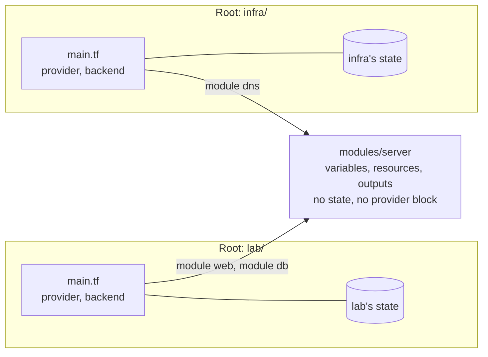

# What a root module is in Terraform/OpenTofu, and why the state belongs to it

Fifth entry in the HashiCorp series. [The first entry](what-is-terraform-opentofu-and-how-it-works.md) listed `module` among the blocks you write, and explained the *state file*, Terraform's record of what it created, and *providers*, the plugins that turn a resource block into API calls. This one is about the word that comes before "module" in most error messages and docs: *root*.

Everything here applies to Terraform and OpenTofu alike; the commands use `tofu`.

## A module is a directory; the root is the one you run in

OpenTofu's [Modules](https://opentofu.org/docs/language/modules/) page defines both terms:

- the **root module**: *"Every OpenTofu configuration has at least one module, known as its root module, which consists of the resources defined in the .tf or .tofu files in the main working directory."*
- a **child module**: *"An OpenTofu module (usually the root module of a configuration) can call other modules to include their resources into the configuration. A module that has been called by another module is often referred to as a child module."*

So a *module* is just a directory of `.tf` files. A module block's `source` says which directory to call: a local path such as `../modules/server`, a Git URL, or a registry address. "Root" isn't a kind of directory, it's a role: the directory where you type `tofu init`, `plan` and `apply`.

## A small example: one module, called twice

Two directories. `modules/server` takes a name and records it; it uses `terraform_data`, a resource built into OpenTofu, so the example needs no cloud account and downloads nothing:

```hcl
# modules/server/main.tf
variable "name" {
  type = string
}

resource "terraform_data" "server" {
  input = var.name
}

output "name" {
  value = terraform_data.server.output
}
```

`lab` calls it twice, once per server:

```hcl
# lab/main.tf
module "web" {
  source = "../modules/server"
  name   = "web01"
}

module "db" {
  source = "../modules/server"
  name   = "db01"
}

output "servers" {
  value = [module.web.name, module.db.name]
}
```

The module's `variable` blocks are its inputs and its `output` blocks are what the caller can read back, as `module.web.name`. Running OpenTofu in `lab` makes `lab` the root; `init` resolves both calls:

```console
$ cd lab
$ tofu init
Initializing the backend...
Initializing modules...
- db in ../modules/server
- web in ../modules/server
...
$ tofu apply -auto-approve
...
Outputs:

servers = [
  "web01",
  "db01",
]
```

`init` records where it found each module in `.terraform/modules/modules.json`; the entry with an empty key is the root itself:

```json
{"Modules":[{"Key":"","Source":"","Dir":"."},
            {"Key":"db","Source":"../modules/server","Dir":"../modules/server"},
            {"Key":"web","Source":"../modules/server","Dir":"../modules/server"}]}
```

## The state belongs to the root, and only to the root

After the apply, there is one state file, and it's in `lab`:

```console
$ find . -maxdepth 1 -name '*.tfstate*'
./terraform.tfstate
$ ls ../modules/server
main.tf
$ tofu state list
module.db.terraform_data.server
module.web.terraform_data.server
```

The module's directory has no state of its own. Its resources live in the root's state, under an address that says which call created them: `module.web.terraform_data.server`. The same module called twice gives two resources, because the address includes the call's name.

Two consequences follow:

- **A module can be shared by several roots, and each keeps its own state.** Another root could call `modules/server` for its own servers; neither root would see the other's resources.
- **Moving a resource into a module changes its address.** `terraform_data.server` in the root and `module.web.terraform_data.server` are different addresses, so without help, `plan` would destroy one and create the other. That's what the `moved` block in [the state entry](state-locking-inspection-refactoring-drift.md) is for.

The *backend* is where a root stores that state: a local `terraform.tfstate` file by default, as here, or a remote store such as S3 or [GitLab's HTTP backend](opentofu-gitlab-pipeline-managed-state-component.md). One root, one backend, one state.

## Run OpenTofu in a module's directory, and it becomes a root

Nothing marks `modules/server` as a child module. Run `plan` there and it is the root, which OpenTofu's error message says in so many words:

```console
$ cd ../modules/server
$ tofu init
$ tofu plan -input=false
Error: No value for required variable
  on main.tf line 1:
   1: variable "name" {
The root module input variable "name" is not set, and has no default value.
Use a -var or -var-file command line argument to provide a value for this
variable.
$ tofu plan -input=false -var name=test01
  # terraform_data.server will be created
Plan: 1 to add, 0 to change, 0 to destroy.
```

An `apply` there would write a third, separate `terraform.tfstate` in the module's directory. That's how a module gets tested on its own; it's also how a state ends up somewhere nobody expects it.

## What only the root may hold: provider configurations and the backend

Because the root owns the state and runs the providers, two kinds of configuration belong to it alone.

**Provider configurations.** OpenTofu's [Providers Within Modules](https://opentofu.org/docs/language/modules/develop/providers/) page: *"Provider configurations can be defined only in a root module."* and *"A module intended to be called by one or more other modules must not contain any `provider` blocks."* A child module still says which providers it needs, with versions, in `required_providers`; the root configures them (endpoint, credentials) and passes them down. A module that does carry a `provider` block *"is not compatible with the `for_each`, `count`, and `depends_on` meta-arguments"*.

**The backend.** The [Backend Configuration](https://opentofu.org/docs/language/settings/backends/configuration/) page says a backend goes in a `backend` block inside the `terraform` block, and that *"A configuration can only provide one backend block"*. It doesn't say what happens to one in a child module, so here's the test: the same `backend "local"` block added to `modules/server`, then `init` from `lab` again:

```console
$ tofu init
...
Warning: Backend configuration ignored
  on ../modules/server/main.tf line 14, in terraform:
  14:   backend "local" {
Any selected backend applies to the entire configuration, so OpenTofu expects
provider configurations only in the root module.
This is a warning rather than an error because it's sometimes convenient to
temporarily call a root module as a child module for testing purposes, but
this backend configuration block will have no effect.
```

A warning, not an error, and the block has no effect: the state still goes where the root says. (The middle sentence says "provider configurations" where it means the backend; that's OpenTofu's wording, not a typo here.)

## Several roots: one state each



Since each root has its own state, the split between roots decides what one `plan` or `apply` can touch. A root that creates a database server and a root that creates the servers that use it are planned, applied, locked and destroyed separately: a `destroy` in one can't reach the other. The price is that one root can't read the other's resources directly; it has to get what it needs some other way, such as a data source that queries the real API.

Checked with OpenTofu 1.13.9.
