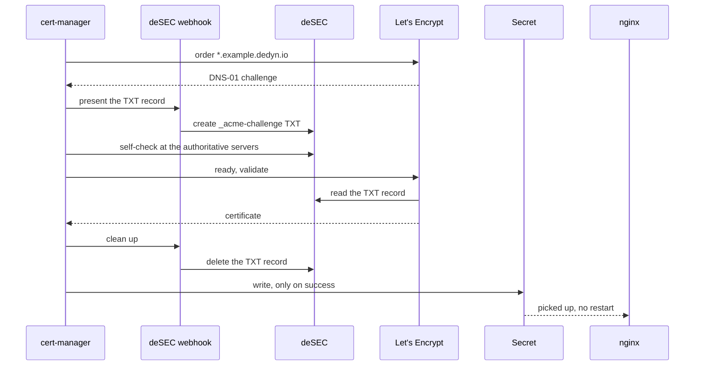

# A wildcard certificate for a private Kubernetes cluster: cert-manager, DNS-01 and deSEC

A follow-up to [Let's Encrypt for a LAN-only service with Caddy](caddy-dns-01-desec-dedyn-io.md), which explains the *DNS-01 challenge* and deSEC's *token policies*; this entry relies on both. There, Caddy fetched the certificate for one service. Here the service is a Kubernetes cluster on a private address: a wildcard certificate `*.example.dedyn.io`, held in one Secret, serves several web applications behind one ingress controller. It was issued by hand and nothing renewed it. The fix is to let the cluster renew it itself.

The terms this relies on:

- A **Secret** is a Kubernetes object that holds sensitive data. A `kubernetes.io/tls` Secret holds a certificate (`tls.crt`) and its private key (`tls.key`).
- An **ingress controller** is the reverse proxy at the edge of the cluster (nginx here). **Ingress** objects tell it which hostname goes to which Service, and which TLS Secret to present for it. The [ingress-nginx entry](../kubernetes/rke2-ingress-traefik-nginx-retirement.md) covers the controllers RKE2 ships.
- A **custom resource** is an object type that isn't built into Kubernetes; a **CRD** (CustomResourceDefinition) adds it to the API, and a **controller** is the program that acts on it, following the loop described in [what Kubernetes is](../kubernetes/what-is-kubernetes-and-how-it-works.md).
- **Helm** installs packaged applications, called *charts*, into a cluster; `--values` passes a file of settings.
- **ACME** is the protocol Let's Encrypt speaks: an *account* places an *order* for some names, proves control of them through *challenges*, then receives the certificate.

## What cert-manager adds

[cert-manager](https://cert-manager.io/) is a controller with its own CRDs. Two of them do the work here:

- An **Issuer** (one namespace) or **ClusterIssuer** (the whole cluster) describes where certificates come from: Let's Encrypt's ACME server, the ACME account key, and how to solve challenges.
- A **Certificate** names what you want (`dnsNames`, key type) and the Secret to write it into (`secretName`).

cert-manager speaks ACME itself, but it can't edit records at every DNS host. For DNS-01 at hosts it doesn't support, it calls a **webhook solver**: a separate small service that implements "add this TXT record" and "remove it" for one DNS API. deSEC has no built-in solver, so a webhook is needed. This lab used [`pr0ton11/cert-manager-desec-webhook`](https://github.com/pr0ton11/cert-manager-desec-webhook) 0.1.7, the only release of it that started on this cluster.



Nothing in this sequence connects to the cluster from outside, which is why it works for a private address.

## 1. A token that can only write the challenge

The token sits in a Secret inside the cluster, so it should be able to do as little as possible. In deSEC, create a token with a **default policy that refuses writes**, plus one policy allowing type `TXT` on subname `_acme-challenge` in the zone. A leak then lets someone add TXT records at one name, not repoint the web applications.

Use a new token for this, not one that manages the zone's other records.

## 2. Install cert-manager and the webhook

The chart values that matter:

```yaml
# values-cert-manager.yaml
crds:
  enabled: true
  keep: true          # uninstalling the chart keeps the CRDs, and every Certificate with them
dns01RecursiveNameservers: "1.1.1.1:53,9.9.9.9:53"
```

```bash
helm repo add jetstack https://charts.jetstack.io
helm upgrade --install cert-manager jetstack/cert-manager --version v1.20.5 \
  --namespace cert-manager --create-namespace --values values-cert-manager.yaml --wait

# the token, read so it stays out of the shell history
printf 'token: '; read -rs t; echo
kubectl -n cert-manager create secret generic desec-token --from-literal=token="$t"; unset t

# the webhook's chart is published as an OCI artifact on ghcr.io
helm upgrade --install desec-webhook oci://ghcr.io/pr0ton11/helm/cert-manager-desec-webhook \
  --version 0.1.7 --namespace cert-manager --set 'secretName={desec-token}' --wait
```

In the lab, `helm` couldn't pull from `oci://` because of a broken Docker credential helper on the machine, so the chart was fetched anonymously from the ghcr.io registry API with `curl` and installed from the `.tgz`; the chart and values were the same.

**Why `dns01RecursiveNameservers`.** Before telling Let's Encrypt to look, cert-manager runs a *self-check*: it finds the zone's *authoritative* nameservers (deSEC's own) by asking a *recursive* resolver (the one that answers ordinary lookups, from the node's `/etc/resolv.conf` by default), then asks the authoritative servers whether the TXT record is there. This node resolved through NextDNS, a filtering resolver that rewrote some names of this zone to LAN addresses. Pointing the first step at public resolvers takes it out of the path. The self-check itself still goes to deSEC's servers, unless `--dns01-recursive-nameservers-only` is also set.

**If the zone is managed as code** (octoDNS, Terraform's DNS providers), make sure the tool ignores `_acme-challenge`, or it may delete the record mid-challenge or report it as drift.

## 3. Two ClusterIssuers, staging first

Let's Encrypt's *staging* server issues certificates no browser trusts, with much higher rate limits. Production allows only 5 certificates for the same set of names per 7 days, so a loop of failed attempts there can lock you out for a week. The two issuers differ only in name, server and account key:

```yaml
apiVersion: cert-manager.io/v1
kind: ClusterIssuer
metadata:
  name: letsencrypt-staging
spec:
  acme:
    server: https://acme-staging-v02.api.letsencrypt.org/directory
    privateKeySecretRef:
      name: letsencrypt-staging-account   # the ACME account key, created by cert-manager
    solvers:
      - selector:
          dnsZones: [example.dedyn.io]
        dns01:
          webhook:
            groupName: acme.pr0ton11.github.com   # fixed by this webhook
            solverName: desec
            config:
              apiKeySecretRef: {name: desec-token, key: token}
```

The production one uses `letsencrypt-production`, `https://acme-v02.api.letsencrypt.org/directory` and its own account Secret. No `email` is set: it isn't required, and Let's Encrypt no longer sends expiry mail. `kubectl get clusterissuer` shows both `Ready` once the accounts are registered.

## 4. A staging certificate into a separate Secret

```yaml
apiVersion: cert-manager.io/v1
kind: Certificate
metadata:
  name: wildcard-staging
  namespace: gitlab
spec:
  secretName: tls-staging          # not the Secret the ingress serves
  dnsNames: ["*.example.dedyn.io"]
  privateKey:
    algorithm: ECDSA
    size: 256
    rotationPolicy: Always         # a new key at every renewal
  issuerRef: {group: cert-manager.io, kind: ClusterIssuer, name: letsencrypt-staging}
```

```bash
kubectl apply -f certificate-staging.yaml
kubectl -n gitlab wait --for=condition=Ready certificate/wildcard-staging --timeout=10m
dig +short @ns1.desec.io TXT _acme-challenge.example.dedyn.io   # appears, then disappears
```

A separate `secretName` proves the whole chain (token, webhook, self-check, account) while the live Secret stays untouched. Here it was `Ready` in 194 s. If it stays pending, `kubectl -n gitlab describe challenge` shows the step it's stuck on, and the webhook's logs show deSEC's answer: a `403` points at the token's policies.

## 5. Take over the live Secret

The production Certificate is the same with `name: wildcard`, the production issuer, and `secretName` set to the Secret the Ingresses already use. Back up that Secret first, private key included:

```bash
(umask 077; kubectl -n gitlab get secret gitlab-tls -o yaml > ~/gitlab-tls-backup.yaml)
kubectl apply -f certificate-production.yaml
kubectl -n gitlab wait --for=condition=Ready certificate/wildcard --timeout=10m
echo | openssl s_client -connect gitlab.example.dedyn.io:443 -servername gitlab.example.dedyn.io 2>/dev/null |
  openssl x509 -noout -issuer -serial -dates
```

Here it took 148 s, and nginx served the new certificate without a restart: the controller watches the Secrets its Ingresses reference. Keeping the Secret's name means no Ingress and no chart value changes. [openssl for checking certificates](openssl-checking-cert-dates-and-details.md) has more on the last command.

Three properties make the takeover safe to try:

- **cert-manager writes the Secret only once it holds a valid certificate.** A failed order leaves the old certificate in place.
- **Deleting the Certificate, or cert-manager, leaves the Secret.** That is the default (`enableCertificateOwnerRef: false`); with it set to `true`, the Secret would go with the Certificate.
- **The backup is a full rollback**: delete the Certificate, `kubectl apply -f` the backup.

Then delete the staging Certificate and its Secret.

## Renewal, and what else must change

Without `renewBefore`, cert-manager renews at two thirds of the certificate's life: about 30 days before a 90-day Let's Encrypt certificate expires. `kubectl -n gitlab get certificate` shows the scheduled `RENEWAL TIME`. A lab that is powered off at that moment renews when it next runs, as long as that's before expiry.

Look for anything else that writes the Secret. Here, the install script of the application's Helm chart recreated it from the hand-issued files on every run, which would have replaced each renewed certificate with the old one. It now skips the Secret when a Certificate manages it.

Nothing inside the cluster alerts on a failed renewal unless something like Prometheus watches cert-manager's metrics. Because Let's Encrypt publishes every certificate in public *Certificate Transparency* logs, a check from anywhere can still notice when the newest certificate for the name gets close to expiry.

## Sources

- cert-manager docs: *DNS01* (the self-check, `--dns01-recursive-nameservers` and `--dns01-recursive-nameservers-only`), *Webhook* (`groupName`, `solverName`), *FAQ* (renewal at two thirds of the duration by default; re-issuance triggers).
- [`pr0ton11/cert-manager-desec-webhook`](https://github.com/pr0ton11/cert-manager-desec-webhook) 0.1.7, Apache-2.0.
- Let's Encrypt docs: *Rate Limits* (5 duplicate certificates per 7 days), *Staging Environment*.
- deSEC API docs: *Token Scoping: Policies*.
- Run on 2026-10-31 with cert-manager v1.20.5 and the webhook 0.1.7, on Kubernetes 1.35.1 (RKE2): a server-side dry run of both charts first, then the staging certificate, then the production takeover, with the TXT record checked at `ns1.desec.io`.

These commands ran from the owner's WSL machine against a single-node RKE2 cluster on Hyper-V, not in the cloud container where entries are usually drafted; the hostnames and namespace above stand in for the lab's real ones.
